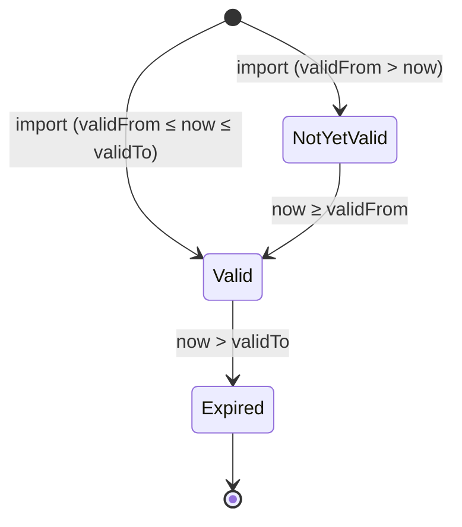
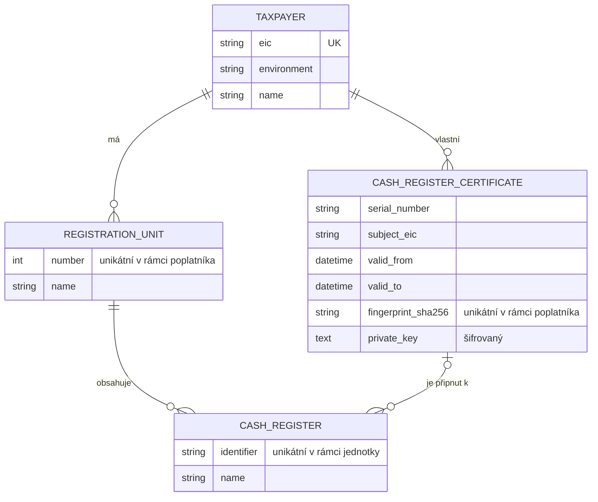

# 11 – Poplatník, evidenční jednotky, pokladní zařízení a pokladní certifikát

> Stav: návrh · Verze: 0.3 · Navazuje na: `spec/00-brief.md`,
> `spec/01-eet-2-0-fakta.md`, `spec/10-interface.md`, odpovědi Q1–Q4 a
> Q16–Q33 v `spec/99-open-questions.md`

## Účel

Hostitelská aplikace (pokladní nebo fakturační systém) eviduje tržby za
jednoho nebo více poplatníků. Balíček v databázi vede poplatníky, jejich
evidenční jednotky, pokladní zařízení a pokladní certifikáty. Pro každý pokus
o odeslání vybere certifikát, kterým se datová zpráva podepíše.

## Pojmy

- **Platný certifikát**: certifikát, pro který v daném okamžiku platí
  `validFrom ≤ now() ≤ validTo`.
- Jediným zdrojem certifikátů jsou certifikáty importované do databáze.
  Certifikát z configu neexistuje (Q27, ruší Q3 → C).

## Pravidla

### Poplatník

- **R1** – Poplatník se zakládá voláním `Eet::createTaxpayer($eic, $name)`.
  EIČ musí odpovídat masce `^CZ[0-9]{8,10}$`, jinak se vyhodí `InvalidEic`
  a nic se neuloží. `[zdroj: R 3.3.3.5]`
- **R2** – EIČ je mezi poplatníky unikátní. Pokus založit druhého poplatníka
  se stejným EIČ vyhodí `DuplicateTaxpayer`.
- **R59** – Každý poplatník má **prostředí** (`Environment`, Q20a → B):
  - `createTaxpayer($eic, $name, $environment)`: bez zadaného prostředí se
    použije config `default_environment` (výchozí `playground`);
  - `Eet::changeEnvironment($taxpayer, $environment)` prostředí změní;
  - změna platí jen pro tržby založené **potom**. Existující tržby se dál
    posílají do prostředí, ve kterém vznikly (R23).

### Evidenční jednotka

- **R3** – Evidenční jednotka patří právě jednomu poplatníkovi a zakládá se
  voláním `Eet::createRegistrationUnit($taxpayer, $number, $name)`. Číslo
  musí odpovídat masce `^[1-9][0-9]{0,8}$` (tj. 1 až 999 999 999), jinak se
  vyhodí `InvalidIdentifier` s polem `registrationUnitNumber`.
  `[zdroj: R 3.3.3.8]`
- **R4** – Číslo evidenční jednotky je unikátní v rámci poplatníka (jinak
  `DuplicateRegistrationUnit`). U různých poplatníků se smí opakovat.
- **R5** – Číslo, které nemá tvar přidělovaný v DIS+ (méně než 2 číslice nebo
  poslední číslice mimo 1–4), se **přijme**. Systém EET na něj reaguje jen
  varováním 6. Model nabízí `RegistrationUnit::hasDisFormat(): bool`, aby
  hostitel mohl obsluhu upozornit už při založení (Q19e → V). Při evidenci
  tržby se neshoda projeví lokálním varováním (R62). `[zdroj: R 2.2.4 bod 5]`

### Pokladní zařízení

- **R6** – Pokladní zařízení patří právě jedné evidenční jednotce a zakládá
  se voláním `Eet::createCashRegister($registrationUnit, $identifier, $name,
  $certificate)`. Označení musí odpovídat masce
  `^[0-9a-zA-Z.,:;/#\-_ ]{1,20}$`, jinak `InvalidIdentifier` s polem
  `cashRegisterId`. `[zdroj: R 3.3.3.9]`
- **R7** – Označení pokladního zařízení je unikátní v rámci evidenční jednotky
  (jinak `DuplicateCashRegister`). V různých evidenčních jednotkách téhož
  poplatníka se smí opakovat. `[zdroj: R 3.3.3.9]`
- **R8** – Pokladní zařízení může mít přiřazený (připnutý) certifikát. Ten
  musí patřit stejnému poplatníkovi jako evidenční jednotka, jinak se vyhodí
  `CertificateTaxpayerMismatch`.

### Pokladní certifikát – import

- **R9** – `Eet::importCertificate($taxpayer, $contents, $password)` přijímá
  obsah souboru ve formátu:
  - PKCS#12 (`.p12`/`.pfx`) s heslem,
  - PEM obsahující certifikát a privátní klíč (klíč může být šifrovaný
    heslem), případně i certifikáty certifikační cesty.

  (Q16 → A) PKCS#12 v legacy formátu CA EET (certifikáty RC2-40, klíč
  3DES) se načte, jen když to umí běhové prostředí (OpenSSL s legacy
  providerem). Jinak se vyhodí `InvalidCertificate` s důvodem
  `UnsupportedLegacyFormat`. Zpráva výjimky odkazuje na převod do PEM
  popsaný v README. `[zdroj: CA – Ochrana soukromého klíče]`
- **R10** – Import selže s `InvalidCertificate` a s jedním z těchto důvodů
  (`CertificateProblem`), přičemž se nic neuloží:
  `Unreadable` (poškozený obsah nebo špatné heslo), `MissingPrivateKey`,
  `KeyMismatch` (klíč nepatří k certifikátu), `Expired` (`validTo < now()`),
  `UnsupportedLegacyFormat` (viz R9). Špatné heslo k PKCS#12 vede vždy
  k `Unreadable`, protože MAC (SHA-1) se ověřuje před dešifrováním, a to
  nezávisle na legacy podpoře.
- **R70** – `Eet::supportsLegacyPkcs12(): bool` říká, zda běhové prostředí
  umí načíst legacy PKCS#12 od CA EET. Import legacy `.p12` se správným
  heslem uspěje, právě když vrací `true`. Jinak skončí
  `UnsupportedLegacyFormat`. Hostitel to může zobrazit obsluze předem.
- **R11** – Certifikát, který zatím neplatí (`validFrom > now()`), se
  importuje. Použije se až od začátku platnosti (R16).
- **R12** – Při importu se uloží: certifikát (PEM), certifikáty certifikační
  cesty, privátní klíč **zašifrovaný Laravel encrypterem**, sériové číslo,
  EIČ ze subjektu (CN), `validFrom`, `validTo` a otisk SHA-256 (DER). Heslo
  k souboru se **neukládá**. `[zdroj: CA; Q3]`
- **R13** – Opakovaný import certifikátu se stejným otiskem pro téhož
  poplatníka nic nového nezaloží a vrátí existující záznam.
- **R14** – CN certifikátu se nemusí shodovat s EIČ poplatníka. Systém EET
  na neshodu reaguje jen varováním 1 a v případě změny EIČ je neshoda
  legitimní. Import se kvůli ní neodmítne (Q21b → A). Neshoda se při
  odeslání projeví jako lokální varování `CertificateEicMismatch` (R62).
  `[zdroj: R 3.3.3.5, P 1.5]`
- **R60** – Balíček **neurčuje** prostředí certifikátu a nekontroluje, zda
  certifikát odpovídá prostředí tržby (Q24). Prostředí určuje jen hostitelská
  aplikace přes prostředí poplatníka (R59). Nesoulad (např. playground
  certifikát u poplatníka v produkci) vyhodnotí systém EET. Typicky vrátí
  chybu 4 (neplatný podpis) a tržba skončí `Rejected` (R33). Důvod: politiky
  (OID) testovacích certifikátů nejsou spolehlivě zdokumentované (PG uvádí
  `…10.4…`, skutečné certifikáty mají `…10.2.102.0.1`).
  `[zdroj: PROD 3.1.2, PG 3.1.5, 01-fakta kap. 5]`
- **R15** – Privátní klíč, obsah importovaného souboru ani heslo se nikdy
  neobjeví v logu, ve zprávě výjimky, ve stack trace, v eventu, v uloženém
  XML ani v serializaci modelu (`toArray()`/`toJson()`). Všechny parametry
  metod (veřejných i interních) a closures, které je přijímají, mají
  atribut `#[\SensitiveParameter]`. Dešifrovaný klíč se drží jen jako
  `OpenSSLAsymmetricKey`, nikdy jako vlastnost serializovatelného objektu.
- **R69** – Uložený klíč, který nejde dešifrovat (např. po změně `APP_KEY`
  bez `APP_PREVIOUS_KEYS`), není kandidátem pro podpis (R16).
  `CashRegisterCertificate::isUsable(): bool` vrací `false`. Pokud tím
  nezbude žádný kandidát, pokus skončí `CertificateUnavailable` (opakuje se).
  Výjimka se nevyhodí.

### Pokladní certifikát – výběr pro podpis

- **R16** – Certifikát se vybírá **v okamžiku každého pokusu o odeslání**
  (podepisuje se certifikátem platným při odeslání, ne při přijetí tržby).
  Kandidátem je každý platný a použitelný (R69) certifikát poplatníka tržby;
  na prostředí se nehledí (R60). Pořadí výběru (Q17a → A, Q17b → A):
  1. certifikát připnutý k pokladnímu zařízení, pokud je kandidátem;
     když není (vypršel, nejde dešifrovat), pokračuje se krokem 2;
  2. jinak kandidát z certifikátů poplatníka, přičemž **přednost mají
     certifikáty s CN = EIČ poplatníka** (Q32 → A); mezi nimi rozhoduje
     nejpozdější `validTo`, při shodě později importovaný (vyšší `id`).
     Certifikát s jiným CN se v tomto kroku použije, jen když žádný
     kandidát s CN = EIČ neexistuje (legitimní změna EIČ, R14);
  3. jinak certifikát není k dispozici. Pokus skončí výsledkem
     `CertificateUnavailable` (viz `spec/20-evidence-trzby.md`).

  Certifikát jiného poplatníka se nikdy nepoužije (Q27).

  Jeden certifikát smí podepisovat zprávy ze všech pokladních zařízení
  a evidenčních jednotek poplatníka. Připnutí je volitelné.
  `[zdroj: R 3.3; PROD 3.1 „Rozhodnutí o počtu certifikátů a jejich
  přiřazení pokladnám je plně v kompetenci poplatníka.“]`
- **R17** – Balíček nečte certifikát ani heslo z configu. Config klíče
  `certificate.*` neexistují (Q27).

### Artisan příkaz

- **R18** – `php artisan eet:certificate:import {path} {--taxpayer=}
  {--password-stdin}` importuje certifikát ze souboru:
  - Heslo se zadává skrytým vstupem, nebo s `--password-stdin` jako první
    řádek standardního vstupu (pro automatizaci). Volba `--password=`
    neexistuje (Q29). Heslo se vyžaduje, jen když ho soubor potřebuje
    (PKCS#12, šifrovaný PEM klíč). S `--no-interaction` bez
    `--password-stdin` se u takového souboru vypíše chyba a příkaz skončí
    kódem `1`.
  - `--taxpayer` je **EIČ** poplatníka. Neplatný tvar vypíše chybu a skončí
    kódem `1`.
  - Bez `--taxpayer` se poplatník určí podle CN certifikátu. Když CN není
    platné EIČ (R1), příkaz vypíše chybu a skončí kódem `1`. Když poplatník
    (zadaný nebo z CN) neexistuje, příkaz ho založí s prostředím
    `default_environment` (Q21a → A).
  - Když CN neodpovídá EIČ poplatníka zadaného přes `--taxpayer`, vypíše
    varování a certifikát importuje (R14).
  - Při úspěchu vypíše EIČ poplatníka, sériové číslo a `validTo` a skončí
    kódem `0`.
  - Při chybě vypíše důvod (`CertificateProblem`, přeložený) bez citlivých
    údajů a skončí kódem `1`.

## Hraniční a souběžné případy

| Situace | Očekávané chování | Pravidlo |
|---|---|---|
| EIČ `CZ1234567` (7 číslic) nebo `cz12345678` | `InvalidEic` | R1 |
| Evidenční jednotka `0` nebo `1000000000` | `InvalidIdentifier` | R3 |
| Evidenční jednotka `5` (1 číslice) | přijme se | R5 |
| Označení pokladního zařízení 21 znaků nebo s `ž` | `InvalidIdentifier` | R6 |
| Stejné označení pokladního zařízení ve dvou jednotkách | přijme se | R7 |
| Připnutí certifikátu jiného poplatníka | `CertificateTaxpayerMismatch` | R8 |
| Špatné heslo k `.p12` | `InvalidCertificate` / `Unreadable` | R10 |
| Certifikát, který vyprší právě teď (`validTo == now()`) | import projde, při výběru je platný | R10, R16 |
| Dva platné certifikáty, připnutý vypršel | použije se platný s CN = EIČ poplatníka a nejpozdějším `validTo`; s jiným CN jen když jiný není | R16 |
| Poplatník přepnut do produkce, má jen playground certifikát | certifikát se použije, EET vrátí chybu 4, tržba `Rejected` | R16, R60, R33 |
| Žádný platný certifikát poplatníka (jiný poplatník platný má) | pokus `CertificateUnavailable` | R16 |
| Klíč nejde dešifrovat po změně `APP_KEY` | certifikát se přeskočí, případně `CertificateUnavailable` | R69 |
| Stejný soubor importovaný dvakrát | jeden záznam | R13 |

## Stavový diagram (pokladní certifikát)

Stav se nikam neukládá, odvozuje se z času. Za neplatný se certifikát považuje
jen podle doby platnosti; CRL se nekontroluje (mimo rozsah).

## Datový model (ER)

## Veřejný kontrakt

`spec/10-interface.md`: facade metody `createTaxpayer`,
`createRegistrationUnit`, `createCashRegister` a `importCertificate`. Dále modely
`Taxpayer`, `RegistrationUnit`, `CashRegister` a `CashRegisterCertificate`,
tabulky `eet_taxpayers`, `eet_registration_units`, `eet_cash_registers` a
`eet_cash_register_certificates`, metodu `supportsLegacyPkcs12`, příkaz
`eet:certificate:import`, výjimky a enum `CertificateProblem`.

## Akceptační kritéria

- [ ] Poplatníka s EIČ `CZ00000019` lze založit; druhé založení vyhodí `DuplicateTaxpayer`. `[R1, R2]`
- [ ] EIČ `CZ1234567`, `SK12345678` a `cz00000019` vyhodí `InvalidEic` a nic se neuloží. `[R1]`
- [ ] Evidenční jednotky `1`, `5` a `999999999` lze založit; `0` a `1000000000` vyhodí `InvalidIdentifier` (parametr je `int`, takže `01` nelze předat). `[R3, R5]`
- [ ] Druhá evidenční jednotka se stejným číslem u téhož poplatníka vyhodí `DuplicateRegistrationUnit`; u jiného poplatníka projde. `[R4]`
- [ ] Označení `5a/A-q/5:22d_2` projde; prázdné, 21znakové a `POKLADNA–1` (pomlčka mimo ASCII) vyhodí `InvalidIdentifier`. `[R6]`
- [ ] Stejné označení pokladního zařízení ve dvou jednotkách projde, ve stejné jednotce vyhodí `DuplicateCashRegister`. `[R7]`
- [ ] Připnutí certifikátu jiného poplatníka vyhodí `CertificateTaxpayerMismatch`. `[R8]`
- [ ] Import PEM (certifikát + šifrovaný klíč + heslo) uloží certifikát s EIČ z CN, `validTo` a otiskem. `[R9, R12]`
- [ ] Import PKCS#12 se špatným heslem vyhodí `InvalidCertificate` s důvodem `Unreadable`; PEM bez klíče vyhodí `MissingPrivateKey`; PEM s cizím klíčem `KeyMismatch`; prošlý certifikát `Expired`. `[R10]`
- [ ] Certifikát s `validFrom` v budoucnu se importuje a do té doby se pro podpis nevybere. `[R11, R16]`
- [ ] Uložený privátní klíč se nerovná vstupnímu PEM klíči (je šifrovaný) a `toArray()` modelu neobsahuje klíč ani heslo. `[R12, R15]`
- [ ] Dvojí import téhož souboru vrátí stejný záznam. `[R13]`
- [ ] Import certifikátu s CN `CZ683555118` k poplatníkovi `CZ00000019` projde. `[R14]`
- [ ] Výběr certifikátu: připnutý platný > platný s nejpozdějším `validTo` (při shodě vyšší `id`) > `CertificateUnavailable`; certifikát jiného poplatníka se nepoužije nikdy (čas zmrazen přes `travelTo`). `[R16]`
- [ ] Poplatník CZ00000019 má certifikát s CN `CZ00000019` (validTo 2027-05-14) a později importovaný certifikát s CN `CZ683555118` (validTo 2027-12-31): podepisuje se prvním; po vypršení prvního se použije druhý a tržba dostane lokální varování `CertificateEicMismatch`. `[R16, R14]`
- [ ] `createTaxpayer()` bez prostředí použije `default_environment`; `changeEnvironment()` neovlivní existující tržby. `[R59]`
- [ ] Výběr certifikátu nezohledňuje prostředí: u poplatníka v produkci se použije i jediný platný playground certifikát. Testy s playground certifikáty mrazí čas před 14. 5. 2027. `[R16, R60]`
- [ ] `RegistrationUnit::hasDisFormat()` vrací `true` pro `181`, `false` pro `5` a `185`. `[R5]`
- [ ] Config klíče `certificate.*` balíček nečte (nastavení nemá vliv na výběr). `[R17]`
- [ ] Certifikát se zašifrovaným klíčem pod jiným `APP_KEY` má `isUsable() = false` a výběr ho přeskočí. `[R69]`
- [ ] Import legacy `.p12` se správným heslem uspěje právě tehdy, když `supportsLegacyPkcs12()` vrací `true`, jinak `UnsupportedLegacyFormat`; špatné heslo dá vždy `Unreadable`. `[R10, R70]`
- [ ] `importCertificate()` má parametry obsahu a hesla označené `#[\SensitiveParameter]` (ověřeno reflexí). `[R15]`
- [ ] `eet:certificate:import` bez `--taxpayer` založí poplatníka podle CN a skončí kódem 0; se špatným heslem skončí kódem 1 a výstup neobsahuje heslo. `[R18]`
- [ ] `eet:certificate:import --password-stdin` přečte heslo z prvního řádku stdin; volba `--password=` neexistuje; `--taxpayer=XY` (neplatné EIČ) skončí kódem 1. `[R18]`
- [ ] Nešifrovaný PEM se importuje i s `--no-interaction` bez hesla; `.p12` s `--no-interaction` bez `--password-stdin` skončí kódem 1; certifikát s CN `TEST` bez `--taxpayer` skončí kódem 1. `[R18]`

## Mimo rozsah

- Automatizovaná obnova certifikátu přes CA EET API (issue #2).
- Generátor CSV evidenčních jednotek pro DIS+ (issue #3) a další údaje
  evidenční jednotky (druh, CZ-NACE, adresa).
- Úprava a mazání poplatníků, evidenčních jednotek, pokladních zařízení
  a certifikátů přes API balíčku.
- Kontrola CRL a zneplatnění pokladního certifikátu.
- Uložení klíče v externím vaultu nebo HSM.
- Autorizace (kdo smí zakládat poplatníky a importovat certifikáty) je věcí
  hostitelské aplikace; balíček nemá HTTP routy.
