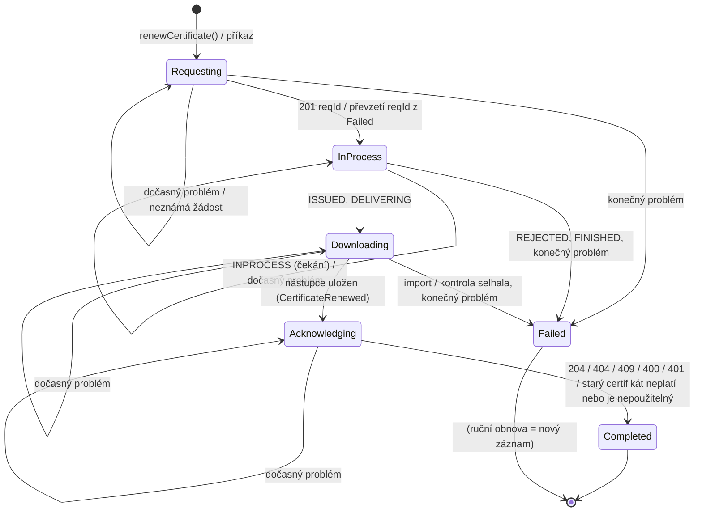
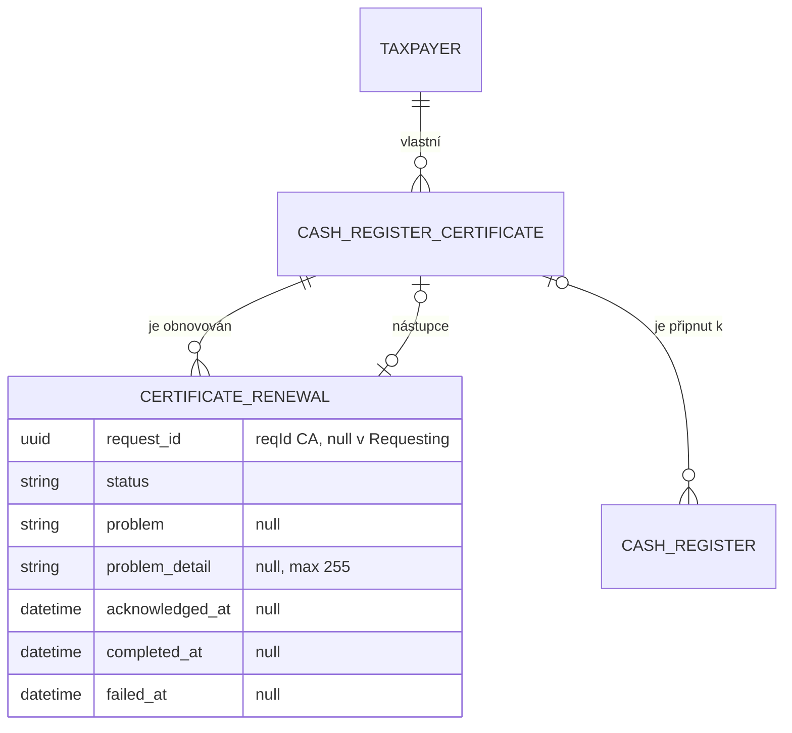

# 12 – Obnova pokladního certifikátu přes CA EET API

> Stav: návrh · Verze: 0.1 · Navazuje na: `spec/01-eet-2-0-fakta.md`
> kap. 5–6, `spec/11-poplatnik-a-certifikat.md`, `spec/10-interface.md`,
> odpovědi Q52–Q75 v `spec/99-open-questions.md` (issue #2)

## Účel

Pokladní certifikát platí 366 dní. Balíček ho před koncem platnosti sám
obnoví přes API CA EET, uloží nástupce a přepne na něj pokladní zařízení,
aby hostitelská aplikace nepřestala podepisovat datové zprávy.

## Pojmy

- **Produkční certifikát**: certifikát, jehož rozšíření `certificatePolicies`
  obsahuje OID začínající `1.2.203.19122063.10.1.` (Q52). Jen ten se
  obnovuje. Jinde (R60) balíček prostředí certifikátu dál neurčuje.
- **Okno obnovy**: certifikát je platný (`validFrom ≤ now() ≤ validTo`)
  a `validTo − now() ≤ renewal.days_before_expiry` dní (Q54).
- **Obnova** (`CertificateRenewal`): záznam o jedné žádosti o následný
  certifikát pro jeden obnovovaný certifikát.
- **Žádost CA** (`requestId`): `reqId` žádosti v CA EET.
- **Nástupce** (`successor`): certifikát uložený obnovou z obnovovaného
  certifikátu. Ručně importovaný certifikát nástupcem není (Q55).
- **Aktivní obnova**: obnova ve stavu `Requesting`, `InProcess`,
  `Downloading` nebo `Acknowledging`.
- **Dočasný problém** / **konečný problém**: viz R101.

## Pravidla

### Předpoklady

- **R90** – Obnovit lze certifikát, který je produkční, platný, použitelný
  (R69) a nemá nástupce. Jinak `Eet::renewCertificate()` vyhodí
  `CertificateNotRenewable` s důvodem `RenewalProblem`
  (`NotProductionCertificate`, `CertificateNotValid`, `CertificateUnusable`,
  `AlreadyRenewed`; při více důvodech první v tomto pořadí) a nic neuloží
  ani neodešle. R90 se kontroluje jen při zakládání **nové** obnovy. Má-li
  certifikát aktivní obnovu, pokračuje se v ní a místo R90 platí R97 a R98
  (např. obnova v `Acknowledging` už má nástupce, a přesto se ack zopakuje). Playground certifikáty (i sdílené testovací) se nikdy
  neobnovují. `[zdroj: CA – obnovovaný certifikát musí být v okamžiku
  volání platný; Q52]`
- **R91** – `Eet::renewCertificate($certificate)` obnoví certifikát i mimo
  okno obnovy (ruční obnova, Q53). Volaná uvnitř otevřené databázové
  transakce hostitele vyhodí `ActiveDatabaseTransaction` stejně jako R72
  (včetně výjimky pro `RefreshDatabase` / `DatabaseTransactions`).
  Konfigurace (`renewal.*`, `proxy`, `lock_store`, `response_max_bytes`) se
  validuje před jakýmkoli zápisem nebo voláním API (R68).

### Průběh obnovy

- **R92** – Jedno volání `renewCertificate()` provede tolik kroků, kolik jde
  (R93–R98), a vrátí záznam obnovy v jeho aktuálním stavu. Výsledek API
  **není výjimka** (stejně jako u `register()`). Má-li certifikát aktivní
  obnovu, pokračuje se v ní; jinak se založí nová ve stavu `Requesting`.
  Certifikát má nejvýš jednu aktivní obnovu.
- **R93** – `Requesting`: před podáním žádosti se zavolá
  `GET /request/not-finished`.
  - `reqId`, který patří dřívější obnově **téhož** certifikátu ve stavu
    `Failed`, se převezme (obnova dostane tento `requestId`, přejde do
    `InProcess` a pokračuje R94; `request_id` zůstává i u dřívější obnovy,
    sloupec není unikátní). Tak jde po konečném problému R97 stáhnout
    PKCS#12 znovu do 30 dnů od vydání (Q58).
  - `reqId`, který patří obnově jiného certifikátu, nebo obnově téhož
    certifikátu, která není `Failed`, se ignoruje (Q73).
  - Převzetí `reqId` z dřívější `Failed` obnovy má přednost před
    neznámými `reqId` ve stejné odpovědi (Q73).
  - Neznámý `reqId` (Q65): nová žádost se nepodá, obnova zůstane
    `Requesting` s dočasným problémem `UnknownPendingRequest` a s `reqId`
    v `problem_detail`.
  - Jinak `POST /request/renew` (bez těla). Odpověď `201` s `reqId` →
    `InProcess`.
- **R94** – `InProcess`: `GET /request/{reqId}/status`.
  - `INPROCESS`: čeká se `pollAfterSeconds` sekund (z těla odpovědi;
    hlavička `Retry-After` se nepoužívá) a dotaz se opakuje.
    Když by čekání skončilo po uplynutí `renewal.max_wait_seconds` od
    začátku volání (výchozí `120`, Q57), nečeká se a obnova zůstane
    `InProcess` bez problému; pokračuje další běh. `max_wait_seconds = 0`
    znamená jediný dotaz. Čeká se přes `Illuminate\Support\Sleep`, takže
    testy smí použít `Sleep::fake(syncWithCarbon: true)`; lhůta se měří
    přes `now()`.
  - `ISSUED` nebo `DELIVERING` → `Downloading` a pokračuje R95.
  - `REJECTED` → `Failed`, problém `Rejected`, `rejectedReason`
    v `problem_detail`.
  - `FINISHED` (stáhl a potvrdil někdo jiný, nebo uplynulo 30 dnů) →
    `Failed`, problém `AlreadyFinished`.
- **R95** – `Downloading`: `POST /request/{reqId}/claim-download` vrátí
  PKCS#12 (base64), heslo a metadata `certificate`. PKCS#12 se zpracuje
  jako import (R9, R10, R12) k poplatníkovi obnovovaného certifikátu
  a navíc musí platit (Q59):
  - CN nového certifikátu = CN obnovovaného,
  - `validTo` nového > `validTo` obnovovaného,
  - sériové číslo (desítkově), `validFrom` a `validTo` se shodují
    s `certificate.sn`, `certificate.validFrom` a `certificate.validTo`,
  - nástupce je produkční certifikát (politika `…10.1.…`),
  - DN vydavatele a identifikátor klíče autority (AKI) nástupce se shodují
    s obnovovaným certifikátem (Q71),
  - v uložené certifikační cestě obnovovaného certifikátu je certifikát,
    jehož subjekt se rovná DN vydavatele obnovovaného certifikátu a který
    podpis obnovovaného certifikátu ověří; podpis nástupce musí ověřit
    jeho veřejný klíč. Když takový certifikát v cestě není (např. PEM
    import bez cesty), je to `CertificateMismatch` (fail closed, Q74).

  Selže-li import, je to konečný problém `CertificateUnreadable`
  (`problem_detail` = hodnota `CertificateProblem` podle R10, např.
  `missing_private_key` u PKCS#12 bez klíče nebo
  `unsupported_legacy_format`). Časy se porovnávají jako okamžiky
  (stejný okamžik v jiném posunu UTC se shoduje). `sn`, které neodpovídá
  `^\d+$`, porušuje schéma API → dočasný problém `TemporaryError` (R101). Nesplní-li certifikát kontrolu, je to
  konečný problém `CertificateMismatch`. V obou případech se nic neuloží
  a `ack-download` se **nepošle** (Q58). Existuje-li certifikát se stejným
  otiskem u poplatníka už (R13), je to `CertificateMismatch`.
- **R96** – Úspěšně zkontrolovaný nástupce se uloží v **jedné transakci**
  spolu s:
  - vazbou obnovy na nástupce (`successor_id`),
  - přepnutím všech pokladních zařízení připnutých k obnovovanému
    certifikátu na nástupce (Q60),
  - přechodem obnovy do `Acknowledging`.

  Obnovovaný certifikát zůstává uložený a nic se nemaže. Po commitu se
  vyvolá `CertificateRenewed`.
- **R97** – `Acknowledging`: `POST /request/{reqId}/ack-download`.
  Odpověď `204`, `404` nebo `409` → `Completed` (`409`/`404` znamená, že CA
  žádost už ukončila). Dočasný problém → zůstane `Acknowledging` a ack
  zopakuje další běh. Když obnovovaný certifikát mezitím přestal platit,
  ack se nepošle a obnova přejde do `Completed` s `acknowledged_at = null`
  a s vynulovaným `problem` i `problem_detail` (předchozí dočasný problém
  nezůstane, Q73). Konečný problém při ackování (HTTP 400, 401) také vede do `Completed`
  s `acknowledged_at = null` a vyplněným `problem` (`RequestFailed`)
  a `problem_detail`. Do `Failed` se z `Acknowledging` nepřechází
  a `CertificateRenewalFailed` se nevyvolá; nástupce zůstává (Q67).
  Když klíč obnovovaného certifikátu nejde dešifrovat (R69), ack se nepošle
  a obnova přejde do `Completed` s `acknowledged_at = null` a
  `problem = CertificateUnusable`, bez eventu selhání (Q69). Odpověď `404`
  nebo `409` také ponechá `acknowledged_at = null` (ack neproběhl).
- **R98** – Je-li obnovovaný certifikát při pokračování obnovy ve stavu
  `Requesting`, `InProcess` nebo `Downloading` už neplatný nebo
  nepoužitelný, obnova přejde do `Failed` s problémem `CertificateNotValid`
  (resp. `CertificateUnusable`) bez volání API.

### Autentizace a transport

- **R99** – Každé volání API nese `Authorization: Bearer <JWT>` s novým
  tokenem (Q63):
  - JWS Compact, hlavička přesně `{"alg":"RS256","typ":"JWT","x5t#S256":…}`,
    kde `x5t#S256` = base64url (bez `=`) SHA-256 otisku DER obnovovaného
    certifikátu;
  - payload přesně `{"iat":T,"exp":T+60}`, `T` = `now()` v sekundách
    Unix;
  - podpis RSA-SHA256 privátním klíčem **obnovovaného** certifikátu,
    bez další Composer závislosti.

  `[zdroj: CA; caeetapi_jwt.yml bearerJwtRs256]`
- **R100** – Volání API jdou přes Laravel HTTP klienta
  (`Illuminate\Support\Facades\Http`), takže testy smí použít
  `Http::fake()`. Platí pravidla transportu R66 obdobně:
  - URL je `renewal.endpoint` + cesta (výchozí
    `https://ca.caeet.gov.cz/api`); schéma `https`, bez userinfo, port
    prázdný nebo 443, hostitel z `renewal.allowed_hosts` (výchozí tři
    hostitelé CA EET), IP adresa nikdy; při `app()->runningUnitTests()`
    i `http://127.0.0.1:<port>`; jinak `InvalidConfiguration`;
  - TLS ověření vždy zapnuté, TLS ≥ 1.2, přesměrování se nenásledují,
    proxy jen z `proxy`, bez globální konfigurace HTTP klienta hostitele,
    hlavička `Accept: application/json`;
  - tělo odpovědi větší než `response_max_bytes` je dočasný problém;
  - volání CA EET API **nevyvolávají HTTP eventy** Laravelu
    (`RequestSending`, `ResponseReceived`, `ConnectionFailed`), aby se JWT,
    PKCS#12 ani heslo nedostaly k listenerům hostitele (Telescope, logy).
    `Http::fake()` (stuby, záznam, `preventStrayRequests`) dál platí
    (Q70). U odesílání tržeb zůstávají eventy podle R66;
  - celé jedno volání je omezené `renewal.timeout_ms` (výchozí `10000`,
    Q66).

### Chyby

- **R101** – Klasifikace problémů (`RenewalProblem`, Q61):
  - konečné problémy v `Acknowledging` řeší R97;
  - **dočasné** (obnova zůstane ve svém stavu, `problem` a
    `problem_detail` se vyplní, další běh to zkusí znovu, dokud certifikát
    platí): `TemporaryError` – síť, timeout, **jakýkoli** HTTP status mimo
    dokumentovaný úspěch (renew `201`, ack `204`, ostatní `200`) a mimo
    `400`/`401`/`404`/`409` (např. `429`, `5xx`, 3xx, `200` z renew),
    příliš velká odpověď, odpověď, která neodpovídá schématu API, `reqId`
    v odpovědi `status`, který se neshoduje s `request_id` obnovy (Q72,
    Q73);
    `UnknownPendingRequest` (R93);
  - **konečné** (obnova přejde do `Failed`): `Rejected`, `AlreadyFinished`,
    `RequestFailed` (HTTP `400`, `401`, `404`, `409` mimo R97),
    `CertificateUnreadable`, `CertificateMismatch`,
    `CertificateNotValid`, `CertificateUnusable`.

  Úspěšný krok `problem` a `problem_detail` vynuluje. `problem_detail`
  obsahuje jen HTTP status a `code`/`message` z `ErrorDTO`, `rejectedReason`
  nebo hodnotu `CertificateProblem`, nejvýš 255 znaků, bez řídicích znaků
  (C0, DEL, C1 se odstraní, Q72); nikdy PKCS#12 ani heslo.
- **R102** – Při přechodu do `Failed` se po commitu vyvolá
  `CertificateRenewalFailed`. Certifikát, jehož poslední obnova je
  `Failed`, příkaz bez `--certificate` přeskočí (automatika se zastaví).
  Znovu jen ručně: `renewCertificate()` nebo
  `eet:certificate:renew --certificate=ID` založí novou obnovu (R93).
- **R103** – PKCS#12, heslo ani privátní klíč nástupce se nikdy neobjeví
  v logu, cache, výjimce, eventu, záznamu obnovy ani v serializaci modelu
  (R15 platí obdobně, včetně výjimky bez bindingů při selhání zápisu
  nástupce, Q75). Parametry, které je přijímají, mají
  `#[\SensitiveParameter]`. Odpověď `claim-download` se nikam neukládá
  a neprojde HTTP eventy (R100). Eventy `CertificateRenewed`
  a `CertificateRenewalFailed` používají `SerializesModels`, takže se do
  fronty listeneru hostitele serializuje jen identifikátor modelu (Q72).
  `[zdroj: CA – vrácené údaje jsou citlivé]`

### Souběh

- **R104** – Pro jeden certifikát běží nejvýš jedna obnova. Vzájemné
  vyloučení zajišťuje cache zámek `laravel-eet-module:certificate:{id}`
  v `lock_store` (pravidla driveru jako R43) s TTL
  `renewal.max_wait_seconds` + 5 × ⌈`renewal.timeout_ms` / 1000⌉ + 60 s (Q72).
  Každý přechod stavu obnovy se zapíše, jen když je obnova v databázi
  stále ve stavu, ze kterého krok vycházel; jinak se krok zahodí
  (souběžný zápis nepřepíše např. `Acknowledging` na `Failed`). Platí to
  i pro porušení unikátního otisku při zápisu nástupce: když obnova po
  rollbacku už není `Downloading`, krok se zahodí; jinak R95
  (`CertificateMismatch`). Když je zámek obsazený,
  `renewCertificate()` vrátí `null` a nic neudělá; příkaz certifikát
  vypíše jako „běží jinde“. Testy smí zámek předem obsadit.

### Artisan příkaz

- **R105** – `php artisan eet:certificate:renew {--taxpayer=*}
  {--certificate=*} {--dry-run}`:
  - bez `--certificate` zpracuje každý certifikát, který má aktivní obnovu
    (i mimo okno), a každý produkční, platný, použitelný certifikát
    v okně obnovy bez nástupce, jehož poslední obnova není `Failed`;
  - `--taxpayer=EIČ` (opakovatelné) omezí výběr na poplatníky; neplatné
    nebo neexistující EIČ vypíše chybu a skončí kódem `1` bez volání API;
  - `--certificate=ID` (opakovatelné) zpracuje jen tyto certifikáty
    i mimo okno a i po `Failed` (ruční obnova); certifikát, který nesplní
    R90, nebo neexistující ID vypíše důvod a ostatní se zpracují;
  - `--certificate` s `--taxpayer`: certifikát jiného poplatníka vypíše
    „nepatří zadanému poplatníkovi“ (kód `1`, Q73);
  - `--dry-run` jen vypíše, co by zpracoval; nevolá API a nic nezapíše.
    Vyhodnotí ale R90: certifikát, který obnovit nejde, vypíše jako
    „nelze obnovit“ s důvodem a příkaz skončí `1` stejně jako ostrý běh
    (Q73);
  - pro každý certifikát vypíše ID, CN, sériové číslo (desítkově),
    `validTo` (`Y-m-d`),
    výsledný stav obnovy a případný problém (přeložený, R58);
  - selhání jednoho certifikátu nezastaví ostatní;
  - skončí kódem `0`, když žádná zpracovaná obnova neskončila `Failed`,
    nemá dočasný problém a žádný předpoklad ani ID neselhaly; jinak `1`.
    `InvalidConfiguration` vypíše klíč a skončí `1`. Obsazený zámek
    („běží jinde“) a `--dry-run` výsledek nezhorší (kód `0`, Q68).
    Neočekávaná výjimka u jednoho certifikátu se vypíše: u výjimek balíčku
    (`EetException`) třída a zpráva, u ostatních (např. `QueryException`
    s bindingy) jen třída (Q72, R103). Ostatní certifikáty se zpracují
    a příkaz skončí `1`.

  Balíček příkaz sám neplánuje; README doporučí denní běh (Q53).

### Hlášení

- **R106** – `eet:status` (R54) navíc vypíše (ID, CN, `validTo`, stav
  a problém poslední obnovy) a skončí kódem `1`, když:
  - některý produkční platný certifikát je v okně obnovy a nemá nástupce,
    nebo
  - poslední obnova některého platného certifikátu je `Failed`, nebo má
    dočasný problém `UnknownPendingRequest`.

  `eet:status` validuje navíc `renewal.days_before_expiry` (R68).

## Hraniční a souběžné případy

| Situace | Očekávané chování | Pravidlo |
|---|---|---|
| `validTo − now()` přesně 21 dní | v okně obnovy | R105 |
| Playground certifikát (`…10.2.102.0.1`) ve `--certificate` | „nelze obnovit“ (`NotProductionCertificate`), bez volání API | R90, R105 |
| Certifikát už má nástupce | `AlreadyRenewed` | R90 |
| `INPROCESS` s `pollAfterSeconds` 200 při `max_wait_seconds` 120 | bez čekání zůstane `InProcess` | R94 |
| Pád po `claim-download` před uložením | další běh: stav `DELIVERING` → nový `claim-download` | R94, R95 |
| Pád po uložení nástupce před `ack-download` | další běh pošle jen ack | R97 |
| `.p12` v legacy formátu bez legacy provideru | `Failed` / `CertificateUnreadable`, bez ack; ruční obnova převezme stejný `reqId` | R93, R95 |
| Nový certifikát má jiné CN | `Failed` / `CertificateMismatch`, bez ack | R95 |
| `not-finished` vrátí neznámý `reqId` | žádná nová žádost, `UnknownPendingRequest`, `eet:status` kód 1 | R93, R106 |
| HTTP 429 při `POST /request/renew` | zůstane `Requesting`, `TemporaryError` | R101 |
| Obnovovaný certifikát vyprší během `InProcess` | `Failed` / `CertificateNotValid` | R98 |
| Starý certifikát vyprší před ackem | `Completed`, `acknowledged_at = null` | R97 |
| Klíč starého certifikátu nejde dešifrovat v `Acknowledging` | `Completed`, `acknowledged_at = null`, `problem = CertificateUnusable`, bez API volání a bez eventu selhání | R97, Q69 |
| Ack se nepovede (500), pak starý certifikát vyprší | `Completed`, `problem = null` | R97, Q73 |
| Obnovovaný certifikát importovaný bez certifikační cesty | `Failed` / `CertificateMismatch`, bez ack, pokladny nepřepnuté | R95, Q74 |
| Self-signed nástupce se správným CN a metadaty | `Failed` / `CertificateMismatch`, pokladny nepřepnuté | R95, Q71 |
| Listener hostitele na `ResponseReceived` | žádný event z volání CA EET | R100, Q70 |
| `status` vrátí jiný `reqId` | `TemporaryError`, stav beze změny | R101, Q72 |
| Ack vrátí 401 | `Completed`, `acknowledged_at = null`, `problem = RequestFailed`, bez eventu selhání | R97, Q67 |
| `renewCertificate()` u certifikátu v `Acknowledging` | ack se zopakuje, `AlreadyRenewed` se nevyhodí | R90, R97 |
| Dva běhy příkazu současně | druhý certifikát přeskočí („běží jinde“) | R104 |
| `renewCertificate()` uvnitř `DB::transaction()` | `ActiveDatabaseTransaction` | R91 |
| Dva certifikáty téhož EIČ s aktivní obnovou | `reqId` druhé obnovy není „neznámý“, ignoruje se | R93 |

## Stavový diagram (obnova)

## Datový model (ER)

## Veřejný kontrakt

`spec/10-interface.md`: facade `renewCertificate`, action `RenewCertificate`,
model `CertificateRenewal` (tabulka `eet_certificate_renewals`), nové metody
a relace `CashRegisterCertificate`, enumy `RenewalStatus` a `RenewalProblem`,
výjimka `CertificateNotRenewable`, eventy `CertificateRenewed`
a `CertificateRenewalFailed`, příkaz `eet:certificate:renew`, rozšíření
`eet:status`, config `renewal.*`, překlady. Žádná změna není BREAKING (nová
tabulka a nové klíče s výchozími hodnotami).

## Akceptační kritéria

- [ ] `renewCertificate()` u playground certifikátu ze zipu vyhodí `CertificateNotRenewable` (`NotProductionCertificate`) a `Http::assertNothingSent()`. `[R90]`
- [ ] U produkčního certifikátu s nástupcem / prošlého / s nedešifrovatelným klíčem vyhodí `AlreadyRenewed` / `CertificateNotValid` / `CertificateUnusable`. `[R90]`
- [ ] Šťastná cesta (`not-finished` prázdné → `201` → `INPROCESS` → `ISSUED` → `claim-download` → `204`) v jednom volání: obnova `Completed`, nástupce uložen u stejného poplatníka, `successor()` vrací nástupce, pokladní zařízení připnutá ke starému jsou připnutá k novému, starý certifikát existuje, `CertificateRenewed` vyvolán jednou. `[R92–R97]`
- [ ] Pořadí volání API odpovídá R93–R97 a `ack-download` přijde až po uložení nástupce. `[R95, R96]`
- [ ] `INPROCESS` s `pollAfterSeconds = 5`, `Sleep::fake(syncWithCarbon: true)`, `max_wait_seconds = 12`: tři dotazy na stav, pak obnova `InProcess` bez problému; další volání pokračuje stejným `reqId` bez nového `POST /request/renew`. `[R94, R92]`
- [ ] `max_wait_seconds = 0`: přesně jeden dotaz na stav. `[R94]`
- [ ] `REJECTED` → `Failed` / `Rejected`, `problem_detail` obsahuje `rejectedReason`, `CertificateRenewalFailed` vyvolán; `FINISHED` → `AlreadyFinished`. `[R94, R101, R102]`
- [ ] PKCS#12 s jiným CN, s `validTo` ≤ starému, nebo s metadaty neodpovídajícími certifikátu → `Failed` / `CertificateMismatch`, nic se neuloží, `ack-download` se nepošle. `[R95]`
- [ ] Nečitelný PKCS#12 (špatné heslo v odpovědi) → `Failed` / `CertificateUnreadable` s `problem_detail` `unreadable`, bez ack. `[R95]`
- [ ] Po `Failed` / `CertificateUnreadable` ruční obnova, kde `not-finished` vrací původní `reqId`: nepošle `POST /request/renew`, převezme `reqId` a dokončí. `[R93, R102]`
- [ ] `not-finished` vrací neznámý `reqId` → obnova `Requesting` / `UnknownPendingRequest`, `POST /request/renew` se nepošle, `eet:status` skončí kódem 1. `[R93, R106]`
- [ ] HTTP 429, 500, timeout a nevalidní JSON → dočasný problém `TemporaryError`, stav se nezmění; 400, 401 → `Failed` / `RequestFailed`. `[R101]`
- [ ] `ack-download` vrátí 500: obnova `Acknowledging`, nástupce uložen; další volání pošle jen ack a skončí `Completed`. Ack 409 → `Completed`. `[R97]`
- [ ] Ack vrátí 401: obnova `Completed`, `acknowledged_at` null, `problem` `RequestFailed`, `CertificateRenewalFailed` se nevyvolá, `successor()` vrací nástupce. `[R97]`
- [ ] Starý certifikát po uložení nástupce vyprší (`travelTo`): další volání ack nepošle, obnova `Completed`, `acknowledged_at` null. `[R97]`
- [ ] Obnovovaný certifikát vyprší během `InProcess`: další volání nevolá API, `Failed` / `CertificateNotValid`. `[R98]`
- [ ] JWT každého požadavku: hlavička a payload přesně podle R99, `exp − iat = 60`, podpis ověřitelný veřejným klíčem obnovovaného certifikátu, `x5t#S256` odpovídá jeho otisku; dva požadavky mají různé tokeny nebo stejný jen při stejném `now()`. `[R99]`
- [ ] `renewal.endpoint` s `http://`, IP adresou, hostitelem mimo allow-list nebo portem 8443 → `InvalidConfiguration` s klíčem `renewal.endpoint` před jakýmkoli zápisem; `days_before_expiry = 0` nebo `366` → `InvalidConfiguration`. `[R91, R100]`
- [ ] Požadavky mají `Accept: application/json` a jdou na `renewal.endpoint` + cesta. `[R100]`
- [ ] Log, eventy, výjimky, `toArray()` obnovy a nástupce neobsahují heslo ani base64 PKCS#12 z odpovědi; parametry s nimi mají `#[\SensitiveParameter]`. `[R103]`
- [ ] Obsazený zámek `laravel-eet-module:certificate:{id}`: `renewCertificate()` vrátí `null` bez volání API; příkaz vypíše „běží jinde“. `[R104]`
- [ ] `renewCertificate()` uvnitř `DB::transaction()` vyhodí `ActiveDatabaseTransaction`. `[R91]`
- [ ] Příkaz bez voleb zpracuje produkční certifikát s `validTo` za 21 dní, nezpracuje ten za 22 dní, playground certifikát ani certifikát s poslední obnovou `Failed`; zpracuje certifikát s aktivní obnovou mimo okno. `[R105]`
- [ ] `--certificate=ID` zpracuje certifikát mimo okno i po `Failed`; neexistující ID vypíše chybu a skončí 1. `--taxpayer=XY` skončí 1 bez volání API. `--dry-run` nevolá API a nic nezapíše. `[R105]`
- [ ] Exit kód příkazu: 0 po `Completed` i po `InProcess` bez problému; 1 po `Failed` nebo dočasném problému. `[R105]`
- [ ] `eet:status` skončí 1 pro produkční certifikát v okně bez nástupce a pro certifikát s poslední obnovou `Failed`; po dokončené obnově (bez jiných problémů) skončí 0. Playground certifikát v okně kód neovlivní. `[R106]`

## Mimo rozsah

- Obnova playground certifikátů a volání testovacího / zkušebního API CA
  EET mimo testy s vlastní konfigurací (Q52).
- Žádost o úplně nový certifikát (ne následný), zneplatnění certifikátu,
  kontrola CRL a stavu `REVOKED` / `ON_CRL`.
- Mazání obnovovaných certifikátů a jejich klíčů po vypršení.
- Plánování příkazu balíčkem (Q53) a obnova přes frontu (Q57).
- UI režim API (session cookie, CSRF).
