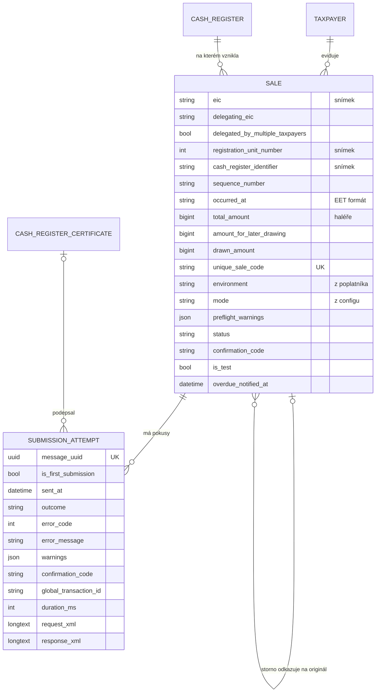

# 20 – Evidence tržby: odeslání, odpověď, opakované zaslání, storno

> Stav: návrh · Verze: 0.7 · Navazuje na: `spec/01-eet-2-0-fakta.md`,
> `spec/11-poplatnik-a-certifikat.md`, `spec/10-interface.md`, odpovědi
> Q4–Q39 v `spec/99-open-questions.md`

## Účel

Hostitelská aplikace předá údaje o evidované tržbě. Balíček je zvaliduje,
uloží, sestaví a podepíše datovou zprávu a synchronně ji odešle. Pak zpracuje
odpověď (POK, chyba, varování). Nepotvrzenou tržbu zasílá znovu, dokud ji
systém EET nepotvrdí nebo neodmítne.

## Pojmy

- **Pokus o odeslání** (`SubmissionAttempt`): jedno odeslání jedné datové
  zprávy (s vlastním UUID) a jeho výsledek (`AttemptOutcome`).
- **Konečný stav tržby**: `Confirmed`, `Verified`, `Rejected`. Ze stavů
  `Confirmed` a `Verified` se už nic neodesílá. `Rejected` je konečný pro
  automatiku a lze ho jen výslovně znovuotevřít (R64).
- **Uvízlá tržba**: `Pending` starší než hranice z R63.
- **Opakovatelný výsledek**: výsledek pokusu, po kterém se tržba zašle znovu
  (tabulka u R33).

## Pravidla

### Vstup a validace

- **R19** – Tržba se eviduje voláním `Eet::register(CashRegister $cashRegister,
  SaleData $data): Sale`. Poplatník a evidenční jednotka se odvodí
  z pokladního zařízení.
- **R20** – Před uložením se kontroluje formát podle XML schématu. Při
  porušení se vyhodí `InvalidSaleData` s polem a důvodem
  (`SaleDataProblem::InvalidFormat`), nic se neuloží ani neodešle:
  - `sequenceNumber`: maska `^[0-9a-zA-Z.,:;/#\-_ ]{1,25}$` `[zdroj: R 3.3.3.10]`
  - `delegatingEic`: maska `^CZ[0-9]{8,10}$`, pokud je zadané `[zdroj: R 3.3.3.6]`
  - částky jsou typu `Amount`, takže rozsah hlídá R56.
- **R21** – Věcné nesrovnalosti se řeší podle tabulky (Q19 → vše podle
  návrhu). **B** = `InvalidSaleData` s uvedeným polem a důvodem, nic se
  neuloží ani neodešle. **V** = tržba se zaeviduje a dostane lokální
  varování (R62). **P** = žádná kontrola.

| # | Nesrovnalost | Řešení | Pole / důvod nebo varování | Zdroj |
|---|---|---|---|---|
| a | `delegatingEic` = EIČ poplatníka | B | `delegatingEic` / `DelegatingEicEqualsTaxpayerEic` | P 3.1–3.3; R 2.2.4 bod 3 |
| b | `occurredAt` > `now()` + 2 h | V | `SaleInFuture` | R 2.2.4 bod 4; P 1.11 |
| c | `occurredAt` < `now()` − 2 roky | B | `occurredAt` / `TooOld` | R 2.2.4 bod 4 |
| d | `occurredAt` < minimální datum prostředí tržby (R61) | B | `occurredAt` / `BeforeEnvironmentStart` | R 2.2.4 bod 4; PG/PROD 4.1 |
| e | číslo evidenční jednotky nemá tvar z DIS+ (R5) | V | `UnusualRegistrationUnitNumber` | R 2.2.4 bod 5 |
| f | CN vybraného certifikátu ≠ EIČ poplatníka | V | `CertificateEicMismatch` | R 2.2.4 bod 1; P 1.5 |
| g | `amountForLaterDrawing` nebo `drawnAmount` je nenulová a má opačné znaménko než `totalAmount` | B | dotčené pole / `SignMismatch` | P 1.13, 1.14 |
| h | \|`amountForLaterDrawing` + `drawnAmount`\| > \|`totalAmount`\| (nezadaná část = 0) | B | `totalAmount` / `PartsExceedTotal` | P 1.13, 1.14 |
| i | `totalAmount` = 0 | P | – | P 5.4 př. 3 |
| j | storno vyšší než originál nebo součet storen nad originál | P | – | P 4, 5.4 |

  Hranice jsou ostré: přesně `now() + 2 h` a přesně `now() − 2 roky`
  (kalendářně) se ještě přijmou. Případ **f** se vyhodnocuje při každém
  pokusu po výběru certifikátu, ostatní jednou při `register()`/`reverse()`.
  Kontroly B běží v pořadí tabulky (a, c, d, g, h) a vyhodí se první
  porušená. „Opačné znaménko“ (g) platí jen tehdy, když jsou část
  i `totalAmount` nenulové. Nenulová část při nulové `totalAmount` spadá
  pod h. U g se nejdřív kontroluje `amountForLaterDrawing`, potom
  `drawnAmount`.
- **R61** – Minimální `occurredAt` podle prostředí tržby se čte z configu
  `minimum_occurred_at.playground` (výchozí `2026-07-01 00:00`)
  a `minimum_occurred_at.production` (výchozí `2026-11-01 00:00`, začátek
  přechodného režimu). Hodnoty jsou v časové zóně `timezone`.
  `[zdroj: PG 4.1, PROD 4.1, R 2.2.4]`
- **R62** – Lokální varování (`PreflightWarning`: `SaleInFuture`,
  `UnusualRegistrationUnitNumber`, `CertificateEicMismatch`) se ukládají
  u tržby bez duplicit a vrací je `Sale::preflightWarnings()`. Když tržba
  dostane nové lokální varování, vyvolá se event `SalePreflightWarned`.
  Lokální varování nikdy nezastaví odeslání.
- **R22** – Nepovinné údaje (`delegatingEic`, `amountForLaterDrawing`,
  `drawnAmount`) se do zprávy zapíšou, jen když jsou zadané. Atribut
  `povereni_vice_popl="true"` se zapíše, jen když je
  `delegatedByMultipleTaxpayers = true`. Prázdný atribut se nezapíše nikdy.
  Částka 0 je zadaná hodnota a zapíše se jako `0.00`. `[zdroj: R 3.3.2, P 1]`

### Uložení a jednoznačnost

- **R23** – Tržba si při vzniku uloží snímek údajů oblasti `Data`: EIČ
  poplatníka, číslo evidenční jednotky, označení pokladního zařízení,
  pořadové číslo, `occurredAt`, částky a údaje o pověření. Ukládá také
  **prostředí poplatníka** (R59) a **mód z configu** platné v okamžiku
  vzniku (Q20 → uložit; Q20a → prostředí per poplatník). Každé opakované
  zaslání použije tento snímek beze změny, i když se mezitím změní config,
  prostředí poplatníka nebo související záznamy. Opakované zaslání se
  neblokuje ani mimo `app()->environment('production')` (Q20b → A).
  `[zdroj: P 6]`
- **R24** – `occurredAt` i `sentAt` se formátují jako `Y-m-d\TH:i:sP`
  v časové zóně `laravel-eet-module.timezone` (výchozí `Europe/Prague`, tedy
  +01:00 v zimě a +02:00 v létě). Zlomky sekund se zahazují.
  `[zdroj: R 3.3.3.2, R 3.3.3.11]`
- **R25** – Jednoznačný kód tržby je
  `eic|id_jednotky|id_pokl|porad_cis|dat_trzby|celk_trzba` v přesně
  odesílaném tvaru. `[zdroj: R 4]`
- **R26** – Když tržba se stejným jednoznačným kódem už existuje **ve
  stejném prostředí** a všechny ostatní údaje snímku (`delegatingEic`,
  `delegatedByMultipleTaxpayers`, `amountForLaterDrawing`, `drawnAmount`) se
  shodují, `register()` vrátí existující tržbu beze změny v jakémkoli stavu.
  Neuloží nic nového, neodešle žádný pokus a nevyvolá žádný event. Platí to
  i pro dva souběžné požadavky, kdy vznikne nejvýš jedna tržba. Když se
  některý z těchto údajů liší, vyhodí se `DuplicateSequenceNumber` a nic se
  neuloží. Tržba z jiného prostředí se nebere v úvahu: tatáž tržba smí
  existovat jednou v `playground` a jednou v `production`. (Q10)
- **R27** – Když ve stejném prostředí existuje tržba se stejnou pěticí
  `(eic, id_jednotky, id_pokl, porad_cis, dat_trzby)`, ale s jinou celkovou
  částkou, vyhodí se `DuplicateSequenceNumber` a nic se neuloží.
  `[zdroj: R 3.3.3.10]`
- **R28** – Tržba se uloží se stavem `Pending` a zápis se potvrdí **před**
  síťovým voláním. Když proces spadne během odesílání, tržba v databázi
  zůstane.
- **R72** – `register()`, `reverse()` a `resubmit()` volané uvnitř otevřené
  databázové transakce hostitele (na spojení modelů balíčku) vyhodí
  `ActiveDatabaseTransaction` a nic neuloží ani neodešle. Jinak by rollback
  hostitele smazal doklad o tržbě, kterou EET už přijal (R28). Když běží
  testy (`app()->runningUnitTests()`), nepočítá se transakce, kterou
  otevřel testovací trait `RefreshDatabase` nebo `DatabaseTransactions`.
  Transakce otevřená navíc uvnitř testu se počítá (Q34 → A).
- **R63** – **Uvízlá tržba** (Q26 → A): tržba `Pending`, jejíž `created_at`
  je starší než `2 × response_timeout_ms + 60 s` (výchozí 68 s), se pro
  R43, R44, R45, R53 a R54 chová jako `Unconfirmed`. Hodnota
  `prvni_zaslani` se řídí R29. Hranice je ostrá: přesně 68 s ještě uvízlá
  není.
- **R68** – Konfigurace se validuje na začátku každé veřejné operace, která
  ji potřebuje (`createTaxpayer`, `changeEnvironment`, `register`,
  `reverse`, `resubmit`, `verifyConnection`, job, příkazy), a to **před**
  jakýmkoli zápisem nebo odesláním. Každá operace validuje **jen klíče, které
  sama používá**: `createTaxpayer` a `changeEnvironment` jen
  `default_environment`; operace, které odesílají (`register`, `reverse`,
  `resubmit`, `verifyConnection`, job, `eet:verify`, `eet:resubmit`), všechny
  klíče kromě `retention.*`; `eet:prune` jen `retention.*`; `eet:status`
  jen `mode`, `response_signer.*`, `response_trust_store`,
  `response_trust_store_max_certificates` a `response_timeout_ms` (hranice
  uvízlé tržby R63); `eet:certificate:import` jen
  `default_environment`. Horní meze `response_timeout_ms` ani
  `response_clock_tolerance_seconds` nejsou (Q36: výchozí hodnoty,
  upravitelné). Hodnota mimo sloupec „Platné hodnoty“
  v `spec/10-interface.md` kap. 10 vyhodí `InvalidConfiguration` s názvem
  klíče (`$key`). Job při `InvalidConfiguration` selže bez záznamu pokusu
  a tržba zůstane ve svém stavu. Příkaz při `InvalidConfiguration` vypíše
  klíč a skončí kódem `1`.

### Datová zpráva a podpis

- **R29** – Každý pokus o odeslání má nové UUID verze 4. Generuje ho balíček
  sám (bez další závislosti).
  - `Eet::createMessageUuidsUsing(?callable $factory)` ho umožní v testech
    určit; `null` vrátí výchozí generátor.
  - Mimo testy (`app()->runningUnitTests()` je `false`) vyhodí metoda
    `\LogicException` (Q33). Hodnota z továrny, která neodpovídá masce UUID v4
    `^[0-9a-fA-F]{8}-[0-9a-fA-F]{4}-4[0-9a-fA-F]{3}-[89abAB][0-9a-fA-F]{3}-[0-9a-fA-F]{12}$`,
    vyhodí `\LogicException` a nic se neodešle. UUID prvního pokusu se
    vygeneruje a ověří ještě **před** uložením tržby (R28), takže neplatná
    továrna nic neuloží.
  - `prvni_zaslani="true"` má první pokus, při kterém se zpráva skutečně
    odeslala. Pokusy `CertificateUnavailable` nic neodeslaly a nepočítají
    se. Každé další odeslání má `"false"`. Pokus `CertificateUnavailable` přesto uloží
    `is_first_submission` s hodnotou, která by se odeslala (`true`, dokud se
    nic neodeslalo).
  - `dat_odesl` je `now()` v okamžiku pokusu.

  `[zdroj: R 3.3.3.1, R 3.3.3.3, P 1.1, P 1.3]`
- **R30** – Odesílaná zpráva vyhovuje `EETXMLSchema.xsd` 4.1:
  - v ostrém módu se atribut `overeni` vůbec neuvede,
  - v ověřovacím módu se uvede `overeni="true"`,
  - částky jsou v kanonickém tvaru (R56).

  `[zdroj: R 3.3.3.4, X]`
- **R31** – Zpráva se podepisuje podle WS-Security tak, jak popisuje
  `spec/01-eet-2-0-fakta.md` kap. 4:
  - podepsán je právě `soap:Body` (s `wsu:Id`),
  - kanonizace Exclusive C14N, digest SHA-256, podpis RSA-SHA256,
  - certifikát je v `wsse:BinarySecurityToken` a odkazuje na něj
    `wsse:SecurityTokenReference`,
  - žádné další hlavičky (Timestamp, WS-Addressing).

  Podpis musí jít ověřit veřejným klíčem certifikátu z `BinarySecurityToken`.
  Certifikát se vybírá podle R16. `[zdroj: R 5.2, V]`

### Odeslání

- **R32** – Zpráva se posílá metodou `POST` na endpoint prostředí uloženého
  u tržby (`endpoints.playground` / `endpoints.production`) s hlavičkami
  `Content-Type: text/xml; charset=utf-8` a
  `SOAPAction: http://fs.gov.cz/eet/OdeslaniTrzby`.
  - Ověření TLS certifikátu serveru je vždy zapnuté a nejde vypnout.
  - Celý pokus (spojení i odpověď) je omezen mezní dobou odezvy
    `response_timeout_ms` (výchozí **4000 ms**, Q5).
  - Hodnota menší než 2000 ms je chyba konfigurace (`InvalidConfiguration`).
  - Odesílá se přes Laravel HTTP klienta (`Illuminate\Support\Facades\Http`),
    takže testy smí použít `Http::fake()` (R57).

  `[zdroj: R 2.3, R 5.1, P 6; PG/PROD 2.1]`
- **R66** – Zabezpečení transportu:
  - endpoint musí mít schéma `https`, žádné userinfo, port prázdný nebo
    443 a hostitele z allow-listu `endpoints.allowed_hosts.<prostředí>`
    (výchozí: produkce `['trzbyeet.gov.cz']`, playground
    `['pg.trzbyeet.gov.cz']`; Q36 → výchozí hodnota, upravitelná). Hostitel
    se porovnává přesně, bez rozlišení velikosti písmen; koncová tečka
    (`trzbyeet.gov.cz.`) se před porovnáním odstraní, takže se přijme. Jinak `InvalidConfiguration` (R68). IP adresa v jakémkoli zápisu
    není povolená nikdy, ani v allow-listu. `[zdroj: PG/PROD 2.1]`;
    Jediná výjimka (Q42 → A): při `app()->runningUnitTests()` se přijme i
    endpoint `http://127.0.0.1:<port>/…` (loopback, libovolný port), aby
    integrační testy mohly poslat skutečný požadavek přes cURL na lokální
    server. Mimo testy se takový endpoint odmítne `InvalidConfiguration`;
  - minimální verze TLS je 1.2;
  - přesměrování se nenásledují; odpověď 3xx je `TransportError`;
  - každý pokus otevírá nové spojení (`Connection: close`), aby se
    respektovalo DNS TTL;
  - proxy se použije jen z configu `proxy` (výchozí `null`); proměnné
    prostředí `HTTP(S)_PROXY` se ignorují;
  - požadavek se sestavuje **úplně bez globální konfigurace HTTP klienta
    hostitele**: bez `Http::globalOptions()` i bez globálního middleware
    (`Http::globalMiddleware()`, `globalRequestMiddleware()`,
    `globalResponseMiddleware()`), v Laravelu přes
    `Http::withoutGlobalConfiguration()`. `Http::fake()` (stuby, záznam,
    `preventStrayRequests`) dál platí. Hostitel může požadavky sledovat jen
    přes eventy `RequestSending` a `ResponseReceived` (Q43 → A);
  - požadavek neposílá `Accept-Encoding` a dekomprese je vypnutá (R65);
  - tělo odpovědi větší než `response_max_bytes` (výchozí 65 536 B) je
    `TransportError`. Měří se při čtení, i bez `Content-Length`;
  - u `TransportError` se do `error_message` pokusu uloží jen kategorie
    (`connection`, `tls`, `redirect`, `too_large`, `content_encoding`,
    `encoding`, `doctype` (také entity, processing instructions a XInclude),
    `invalid_xml`, `soap_fault`, `structure`, `mask`). Texty chyb
    a varování se čistí **odstraněním** nepovolených znaků (R65), nikdy text výjimky. Ten může obsahovat přihlašovací údaje
    proxy.

  `[zdroj: PG/PROD 2.1, 3.2; R 2.3.1]`

### Výsledek pokusu

- **R33** – Každý pokus skončí právě jedním výsledkem `AttemptOutcome`:

| Výsledek | Kdy | Opakovatelný | Stav tržby |
|---|---|---|---|
| `Confirmed` | `Potvrzeni` s platným podpisem (R35), shodným `uuid_zpravy` a hodnotami podle R65 | – | `Confirmed` |
| `Verified` | `Chyba kod="0"` na zprávu v ověřovacím módu | – | `Verified` |
| `Rejected` | `Chyba` s kódem 2, 3, 4, 6 nebo 7 | ne | `Rejected` |
| `TemporaryError` | `Chyba kod="-1"` | ano | `Unconfirmed` |
| `AmbiguousError` | `Chyba` s kódem 8 nebo neznámým kódem; také kód 0 v ostrém módu | ano, s limitem R41 | `Unconfirmed` nebo `Rejected` |
| `Timeout` | odpověď nepřišla v mezní době odezvy | ano | `Unconfirmed` |
| `TransportError` | chyba přenosu (výjimka Guzzle `TransferException` nebo Laravel `HttpClientException`: spojení, TLS, timeout jinak než R32), HTTP odpověď bez čitelného `Odpoved`, SOAP fault, nevalidní XML, porušení R65 nebo R66 | ano | `Unconfirmed` |
| `InvalidResponseSignature` | `Potvrzeni` s neplatným nebo nedůvěryhodným podpisem (R35) | ano | `Unconfirmed` |
| `ResponseMismatch` | `Potvrzeni` bez `uuid_zpravy`; `uuid_zpravy` v jakékoli odpovědi se liší od odeslaného; `Potvrzeni` na zprávu v ověřovacím módu; **tržba `production` a odpověď s `test` = `true`/`1` nebo s POK končícím `-ff`**; **tržba `playground` a odpověď bez `test` = `true`/`1`** | ano | `Unconfirmed` |
| `CertificateUnavailable` | R16 nenašel platný certifikát; nic se neodeslalo | ano | `Unconfirmed` |

  `[zdroj: R 2.2, 3.4, 3.5.4; R 2.2.2 tab. 1 – produkce nikdy nevrací
  `test="true"` ani fiktivní POK; Q7]`
- **R71** – Odpověď se vyhodnocuje v tomto závazném pořadí. První krok,
  který selže, určí výsledek:
  1. **transport:** timeout → `Timeout` (také když vyprší po přijetí hlaviček,
     bez ohledu na HTTP status); chyba spojení, TLS, 3xx nebo
     velikost (R66) → `TransportError`;
  2. **bezpečné parsování** (R65: kódování, DOCTYPE, struktura `Odpoved`)
     a SOAP fault → `TransportError`;
  3. **masky hodnot** (R65) → `TransportError`;
  4. **jen u `Potvrzeni`:** podpis podle R35 (včetně času v kroku 8) →
     `InvalidResponseSignature`;
  5. **shoda** `uuid_zpravy`, módu a prostředí (řádek `ResponseMismatch`)
     → `ResponseMismatch`;
  6. **klasifikace** `Potvrzeni`/`Chyba` podle kódu (ostatní řádky R33).

  U odpovědí `Eet::fake()` jiných než `raw()` se přeskakuje jen krok 4
  (R57).

  Příklad: `Chyba kod="4"` s cizím `uuid_zpravy` je `ResponseMismatch`, ne
  `Rejected`.

  Výjimka, která **není chybou přenosu** (programátorská nebo konfigurační
  chyba, např. `InvalidArgumentException` z Guzzle, `TypeError`), se
  nezachytává a propadne z `register()`, `reverse()`, `resubmit()`, jobu
  i příkazů. Pokus se neuloží, tržba zůstane `Pending` a po hranici R63 ji
  zpracuje `eet:resubmit` (Q41 → A).
- **R34** – Pokus uloží: UUID, `isFirstSubmission`, `sentAt`, výsledek,
  použitý certifikát (otisk), dobu trvání v ms a HTTP status. Pokud jsou
  v odpovědi, uloží také chybový kód a text, `receivedAt` (`dat_prij`),
  `rejectedAt` (`dat_odmit`), POK, příznak `test`, varování (kód + text) a
  `X-Global-Transaction-Id`. `[zdroj: R 3.4.2, 3.5.2, 5.4]`
- **R35** – U `Potvrzeni` se před přijetím POK ověří podpis odpovědi tímto
  závazným postupem. Jakékoli porušení vede k výsledku
  `InvalidResponseSignature`. Tvar odpovědi odpovídá skutečné odpovědi
  playgroundu v `spec/zadani/pg-vzorek/response-potvrzeni.xml`.

  Elementy a atributy se vždy porovnávají podle dvojice (namespace URI,
  lokální jméno). Prefixy v tomto textu jsou jen ilustrativní; skutečná
  odpověď má např. `Signature` v default namespace a dva prefixy pro SOAP
  namespace. Úspěch kryptografické operace je jen návratová hodnota přesně
  `1` nebo `true`; `0`, `-1` i `false` znamenají selhání.
  1. **Struktura:** kořen je `Envelope` (SOAP 1.1) s právě jedním `Header`
     a právě jedním `Body` jako přímými potomky. `Header` obsahuje jen
     jeden element `Security` (WSS secext) a `Security` obsahuje jen právě
     jeden `Signature` (xmldsig) a právě jeden `BinarySecurityToken`; jiný
     element v `Header` nebo `Security` vede k `InvalidResponseSignature`
     (skutečná odpověď nic dalšího neobsahuje):
     - ValueType X509v3, EncodingType Base64Binary;
     - obsah se po odstranění XML whitespace (mezera, tab, CR, LF) dekóduje
       striktním base64 na jeden DER certifikát bez zbytku.
  2. **Reference:**
     - `SignedInfo` má právě jednu `Reference`;
     - její `URI` odpovídá `^#[A-Za-z_][A-Za-z0-9._-]*$`;
     - hodnota za `#` se rovná atributu `Id` v namespace WSU na tom `Body`,
       který je přímým potomkem kořene. Porovnává se přímo, bez
       `getElementById` a XPath `id()`;
     - žádný jiný element dokumentu nemá tutéž hodnotu v jakémkoli
       atributu `Id`, `ID`, `xml:id` ani WSU `Id`;
     - stejné pravidlo platí pro `Reference` v `SecurityTokenReference` →
       `BinarySecurityToken` (včetně `ValueType` X509v3).
  3. **Algoritmy (allow-list):**
     - CanonicalizationMethod i jediná Transform jsou
       `http://www.w3.org/2001/10/xml-exc-c14n#`;
     - jediný povolený potomek je `InclusiveNamespaces` (exc-c14n
       namespace). Jeho `PrefixList` (tokeny `#default` nebo NCName) se
       použije při kanonizaci;
     - DigestMethod je `http://www.w3.org/2001/04/xmlenc#sha256`;
     - SignatureMethod je
       `http://www.w3.org/2001/04/xmldsig-more#rsa-sha256`;
     - klíč certifikátu je **typu RSA** (kontroluje se typ klíče, ne jen
       algoritmus), ≥ 2048 bitů.
  4. **Klíč:** `KeyInfo` obsahuje jen `SecurityTokenReference`
     s `Reference` na ten `BinarySecurityToken`. Jiné formy (`KeyValue`,
     `X509Data`) se odmítnou.
  5. **Kryptografie:** digest exc-c14n `Body` se shoduje s `DigestValue`
     a podpis exc-c14n `SignedInfo` se ověří veřejným klíčem certifikátu.
     Kanonizuje se přesně ta instance DOM, ze které se v kroku 8 čtou data.
  6. **Řetěz certifikátů** (Q28 → A):
     - list → mezilehlý → kotva se ověří podpisem certifikátu
       (`openssl_x509_verify`), ne časovou kontrolou OpenSSL;
     - délka řetězu je přesně 2: vydavatelem listu je mezilehlý certifikát
       z důvěryhodné sady (shoda subjekt/vydavatel i AKI/SKI) a ten je
       vydán kotvou;
     - mezilehlý certifikát má `CA:TRUE` a KeyUsage `keyCertSign`;
     - **platnost všech tří certifikátů se ověřuje k `now()`** (Carbon),
       nikdy k systémovým hodinám, takže ji testy ovládají přes
       `travelTo()`;
     - nepoužije se systémové úložiště certifikátů ani jiné certifikáty ze
       zprávy.
  7. **Identita podepisujícího** (Q28 → A, Q30 → A):
     - list má `CA:FALSE` a KeyUsage `digitalSignature`;
     - v subjektu je atribut OID 2.5.4.97 (`organizationIdentifier`)
       **právě jednou** a rovná se přesně
       `response_signer.organization_identifier` (výchozí
       `NTRCZ-72080043`, GFŘ);
     - CN je v subjektu **právě jednou** a podle prostředí tržby:
       - `playground`: přesně `response_signer.playground.common_name`
         (výchozí `NEOSTRE - playground prostredi EET`);
       - `production`: přesně `response_signer.production.common_name`,
         pokud je nastavené. Dokud je `null` (výchozí, produkční CN zatím
         nikdo neověřil), CN nesmí obsahovat `playground` bez ohledu na
         velikost písmen.
  8. **Čas:** `|dat_prij − now()|` ≤ `response_clock_tolerance_seconds`
     (výchozí 600). Při porušení se do `error_message` pokusu uloží
     `clock_skew` kvůli diagnostice. U ostatních porušení R35 je `error_message`
     `null`.
  9. **Data:** `Odpoved` (UUID, `dat_prij`, POK, `test`, varování) se čte
     **jen z ověřeného `Body`**, nikdy z jiného místa dokumentu.

  U každého ověřeného `Potvrzeni` se u pokusu uloží subjekt (RFC 2253)
  a otisk SHA-256 podpisového certifikátu (`signer_subject`,
  `signer_fingerprint`), aby šlo produkční CN doplnit do configu (Q38 → A).
  „Právě jeden“ se v krocích 1–4 počítá jen z elementů, ne z textových uzlů.
  `SignedInfo` i `Body` se kanonizují v původním dokumentu.

  Důvěryhodné CA (Q23 → A + B): balíček přibaluje v `resources/certs/`
  kotvu důvěry `I.CA Root CA/RSA 05/2022` a mezilehlý certifikát
  `I.CA Public CA/RSA 06/2022` (zdroj: `spec/zadani/ica/`, otisky
  v `01-eet-2-0-fakta.md` kap. 4). Ty platí ve výchozím stavu. Mezilehlý
  certifikát slouží jen k sestavení řetězu, kotvou je pouze kořen.

  Když hostitel nastaví `response_trust_store` (cesta k PEM), použije se
  **místo** přibalených:
  - kotvou jsou v něm jen self-signed certifikáty s `CA:TRUE`, ostatní
    certifikáty s `CA:TRUE` jsou mezilehlé; musí obsahovat aspoň jednu kotvu
    a aspoň jeden mezilehlý certifikát vydaný kotvou (řetěz R35 krok 6 má
    délku 2);
  - soubor, který neexistuje, nemá žádnou kotvu, obsahuje certifikát bez
    `CA:TRUE`, nemá mezilehlý certifikát nebo má víc než
    `response_trust_store_max_certificates` (výchozí 10) certifikátů, je
    `InvalidConfiguration` (R68).
    To vylučuje systémový bundle;
  - testy tak smí použít vlastní testovací CA a podepisující certifikát
    s `organizationIdentifier=NTRCZ-72080043` a CN podle prostředí. Díky tomu
    jdou otestovat všechny řádky R33 i s platně podepsanými, ale věcně
    vadnými odpověďmi.

  Chybová odpověď je podle dokumentace nepodepsaná a přijímá se bez
  ověření. Proto lze konečné odmítnutí ručně zvrátit (R64).
  `[zdroj: R 5.3, PG/PROD 3.3; Q8, Q28, Q30]`
- **R65** – Bezpečné zpracování odpovědi. Porušení vede k `TransportError`.
  - **Kódování a parser:**
    - tělo musí být platné UTF-8 bez bajtu NUL; povolený je jen BOM UTF-8.
      Deklarované kódování (pokud je) musí být `UTF-8` bez ohledu na
      velikost písmen. Jinak se odmítne před parsováním;
    - odpověď s hlavičkou `Content-Encoding` jinou než `identity` se
      odmítne (dekomprese je vypnutá, R66);
    - dokument s `DOCTYPE`, entitami, processing instructions nebo
      XInclude se odmítne bez rozvinutí. Kontroluje se před parsováním
      (bajtově) i po něm. XML deklarace `<?xml …?>` není processing
      instruction;
    - parser nesmí přistupovat k síti ani načítat externí DTD.
  - **Struktura:** `Body` obsahuje právě jeden element `Odpoved` (namespace
    v4). Ten obsahuje právě jednu `Hlavicka`, právě jeden z elementů
    `Potvrzeni`/`Chyba` a 0–10 `Varovani`.
  - **Masky hodnot:**
    - chybějící povinný atribut (`dat_prij` u `Potvrzeni`, `pok`, `kod`,
      `kod_varov`) je porušení masky (kategorie `mask`). Výjimka: chybějící
      `uuid_zpravy` u `Potvrzeni` je `ResponseMismatch` (R33);
    - POK odpovídá masce z R 3.4.2.3 (39 znaků);
    - `uuid_zpravy` odpovídá masce UUID (R 3.3.3.1);
    - `dat_prij` a `dat_odmit` odpovídají masce data a času (R 3.3.3.2)
      **a jsou platné kalendářní datum a čas** (např. `2026-13-45T25:61:61+01:00`
      je porušení masky);
    - `kod` odpovídá `^-?\d{1,3}$`, `kod_varov` `^[1-9]\d{0,2}$`;
    - `test` je `true`, `false`, `1` nebo `0`.
  - **Texty:** texty chyb a varování se před uložením omezí na ASCII 9, 10,
    13 a 32–126 a na 100 znaků. Hodnota `X-Global-Transaction-Id` se omezí
    na 64 znaků z téže sady. Texty mohou obsahovat znaky HTML, takže je
    hostitel musí při zobrazení escapovat (README).

  `[zdroj: R 3.1, 3.4.2, 3.5.2, 5.4]`
- **R36** – POK z neprodukčního prostředí se nikdy nevydává za platný:
  - tržba má `isTest = true`, když odpověď obsahuje `test` = `true` nebo
    `1`, když POK končí na `-ff` (bez ohledu na velikost písmen), nebo když
    tržba vznikla v prostředí `playground`;
  - v produkčním prostředí taková odpověď ke `Confirmed` vůbec nevede
    (R33, `ResponseMismatch`);
  - `Sale::hasValidConfirmationCode()` vrací `true` jen pro stav `Confirmed`
    a zároveň `isTest = false`.

  `[zdroj: R 3.4.2.3–4; Q13]`
- **R37** – Varování se uloží u pokusu a tržba je vystaví přes
  `Sale::warnings()` (z posledního pokusu, který odpověď obsahoval). Neznámý
  kód varování se zachová s `type = null`. `[zdroj: R 3.4.4]`

### Stavy a eventy

- **R38** – Přechody stavu tržby jsou jen ty z diagramu níže. Ze stavů
  `Confirmed` a `Verified` se už nikdy nic neodesílá. Ze stavu `Rejected` se
  odesílá jen po výslovném znovuotevření (R64), nikdy automaticky.
- **R64** – **Znovuotevření odmítnuté tržby** (Q25 → A):
  - `Eet::resubmit($sale)` nebo `eet:resubmit --sale=ID` na tržbu
    `Rejected` ji převede `Rejected → Unconfirmed`, vyvolá event
    `SaleReopened` a hned provede jeden pokus podle R42 (stejná `Data`,
    nové UUID, `prvni_zaslani="false"`, nový výběr certifikátu).
  - Rozhoduje **odmítající pokus**, tedy ten, který tržbu převedl do
    `Rejected`. Ukládá se jako `eet_sales.rejecting_attempt_id`; pozdější
    záznamy pokusů (R67) se nepočítají. Při znovuotevření se
    `rejecting_attempt_id` vynuluje a nastaví se `reopened_at = now()`.
    Zároveň se do `eet_sales.reopened_after_attempt_id` uloží ID posledního
    existujícího pokusu. Počítadlo R41 a pořadí v backoffu R40 počítají
    jen pokusy s vyšším ID (nezávisle na čase, takže to funguje i při
    zmrazeném čase v testech).
  - Bez příznaku je znovuotevření povoleno, jen když odmítající pokus měl
    kód 4 nebo výsledek `AmbiguousError` (kód 8, neznámý kód nebo kód 0
    v ostrém módu po limitu R41).
  - Pro kódy 2, 3, 6 a 7 je potřeba výslovný příznak (Q31 → A):
    `Eet::resubmit($sale, force: true)` nebo
    `eet:resubmit --sale=ID --force`. Bez něj se vyhodí `SaleNotReopenable`
    (nese kód) a nic se neodešle.
  - Znovuotevření nikdy neprovede job ani `eet:resubmit` bez `--sale`.
  - Počítadlo R41 začíná po znovuotevření od nuly.
- **R39** – Eventy se vyvolají až po potvrzení databázového zápisu:
  - `SaleConfirmed` při přechodu do `Confirmed`,
  - `SaleVerified` při přechodu do `Verified`,
  - `SaleRejected` při přechodu do `Rejected` (nese chybový kód posledního
    pokusu),
  - `SaleUnconfirmed` při přechodu `Pending → Unconfirmed`, ne při každém
    dalším neúspěšném pokusu,
  - `SaleReopened` při přechodu `Rejected → Unconfirmed` (R64),
  - `SaleOverdue` viz R44.

### Opakované zaslání

- **R40** – Po opakovatelném výsledku se naplánuje queue job `ResubmitSale`:
  - spojení a fronta podle `resubmission.connection` / `resubmission.queue`,
  - zpoždění podle `resubmission.backoff` (výchozí `[60, 300, 900, 3600]` s,
    po vyčerpání seznamu se opakuje poslední hodnota; Q18). Pořadí v seznamu
    určuje počet všech pokusů od vzniku tržby, resp. po
    `reopened_after_attempt_id` (R64),
    včetně pokusů `CertificateUnavailable`. Každá hodnota
    musí být ≥ `resubmission.min_backoff` (výchozí 30 s, Q35, Q36);
  - **počet pokusů není omezen** (Q6);
  - job se naplánuje až po potvrzení zápisu výsledku a po uvolnění zámku
    R43;
  - spojení fronty (zadané, nebo výchozí) nesmí mít driver `sync`,
    `deferred`, `background` ani `null`, které ignorují zpoždění nebo job
    zahodí. Jinak `InvalidConfiguration` s klíčem `resubmission.connection`
    (R68). Výjimka: při `app()->runningUnitTests()` je `sync` povolený
    (Q35 → A).

  `[zdroj: P 6]`
- **R41** – Výjimka z R40: když celkový počet pokusů s výsledkem
  `AmbiguousError` (ne nutně po sobě jdoucích, počítáno od vzniku tržby
  nebo po `reopened_after_attempt_id`, R64) dosáhne
  `resubmission.max_ambiguous_attempts` (výchozí 3, Q18), tržba přejde do
  `Rejected`. Limitní pokus má výsledek `AmbiguousError` a `SaleRejected`
  nese jeho chybový kód. (Q7)
- **R42** – Opakované zaslání odešle stejná `Data` (R23), nové UUID, aktuální
  `dat_odesl` a `prvni_zaslani="false"`. Certifikát se znovu vybere podle R16.
  `[zdroj: P 6]`
- **R43** – Pro jednu tržbu běží současně nejvýš jeden pokus. Souběžný pokus
  (job a příkaz, dva joby) skončí bez odeslání a bez záznamu pokusu. Job pro
  tržbu, která není `Unconfirmed` ani uvízlá (R63), nic nedělá.
  - Vzájemné vyloučení zajišťuje atomický cache zámek
    `laravel-eet-module:sale:{id}` s TTL `response_timeout_ms` + 30 s
    v cache store `lock_store` (výchozí `null` = výchozí store aplikace).
  - Zámek uvolní jen jeho vlastník.
  - Driver store musí být `redis`, `database`, `memcached`, `dynamodb`
    nebo `file`. U `memo` a `failover` se kontroluje podkladový store,
    případně všechny. Jinak `InvalidConfiguration` s klíčem `lock_store`
    (R68). README upozorní, že `file` nefunguje mezi více servery.
  - Výjimka: při `app()->runningUnitTests()` je povolený i driver `array`
    (výchozí v Testbench), Q35 → A.
  - Testy smí zámek předem obsadit přes `Cache::store(...)->lock()` se
    stejným klíčem.
- **R67** – Výsledek pokusu se do stavu tržby zapíše **podmíněně**:
  - Běžně jen tehdy, když je tržba stále ve stavu, ze kterého pokus
    vycházel (`Pending`, `Unconfirmed`).
  - Výjimka: výsledek `Confirmed` s ověřeným podpisem (R35) se zapíše
    z **jakéhokoli** stavu kromě `Confirmed`, tedy i z `Rejected` po
    souběžném odmítnutí, a vyvolá `SaleConfirmed`.
  - Při zápisu `Confirmed` se `rejecting_attempt_id` vynuluje.
  - Tržba `Confirmed` se nikdy nepřepíše a její POK se nikdy nezmění.
  - Záznam pokusu se uloží vždy.
- **R44** – Tržba v ostrém módu **a v produkčním prostředí**, která je
  `Unconfirmed` (nebo uvízlá, R63) a od jejíhož
  `occurredAt` uplynulo víc než 48 h, vyvolá **jednou** event `SaleOverdue`
  (uloží se `overdueNotifiedAt`). Kontroluje se po každém pokusu a při běhu
  `eet:resubmit` a `eet:status`. Opakované zasílání pokračuje dál.
  `[zdroj: P 6; Q6]`
- **R45** – `Eet::resubmit(Sale $sale, bool $force = false): Sale` provede
  jeden okamžitý pokus, pokud je tržba `Unconfirmed` nebo uvízlá (R63).
  Tržbu `Rejected` znovuotevře podle R64. Tržbu `Confirmed`, `Verified`
  nebo čerstvou `Pending` vrátí beze změny. Nejdřív se získá zámek R43.
  Když je obsazený, vrátí tržbu beze změny: žádné znovuotevření, žádný
  pokus, žádný job.

### Ověřovací mód a ověření spojení

- **R46** – Když je v configu `mode = verification`, tržby se odesílají
  s `overeni="true"` a výsledek `Chyba kod="0"` je převede do `Verified`.
  Na tržby v ověřovacím módu se nevztahuje R44, protože zaslání v ověřovacím
  módu neplní evidenční povinnost. `[zdroj: R 2.2.1]`
- **R47** – `Eet::verifyConnection(CashRegister $cashRegister):
  VerificationResult` pošle zprávu v ověřovacím módu do **aktuálního
  prostředí poplatníka** (R59), s údaji pokladního zařízení,
  podpisem podle R16 a R31, `porad_cis` z configu `verification.sequence_number` (výchozí `"OVERENI"`, Q36), `dat_trzby = now()` a
  `celk_trzba = 0.00`. **Nic neukládá** a nevyvolá žádný event. Vrací
  výsledek (`AttemptOutcome`), chybový kód a text, varování
  a `X-Global-Transaction-Id`. `[zdroj: R 2.2.1]`

### Storno

- **R48** – `Eet::reverse(Sale $original, ReversalData $data): Sale` zaeviduje
  storno jako novou tržbu:
  - celková částka je `−data.amount`, `drawnAmount` je `−data.drawnAmount`,
    pokud je zadaná;
  - `delegatingEic` a `delegatedByMultipleTaxpayers` se převezmou
    z originálu;
  - pokladní zařízení, pořadové číslo a `occurredAt` se berou z `data`
    (může jít o jinou evidenční jednotku nebo pokladní zařízení);
  - dál platí R19–R47.

  `[zdroj: P 4]`
- **R49** – `data.amount` (a `data.drawnAmount`, pokud je zadaná) musí být
  kladné, jinak se vyhodí `InvalidAmount`. Pokladní zařízení musí patřit
  poplatníkovi originálu, jinak `ReversalTaxpayerMismatch`. Když se
  prostředí originálu liší od aktuálního prostředí poplatníka nebo mód
  originálu od aktuálního configu `mode`, vyhodí se
  `ReversalEnvironmentMismatch` a nic se neuloží (Q37 → A). Stav originálu
  ani výše dřívějších storen se nekontroluje.
- **R50** – Storno si lokálně pamatuje originál (`Sale::reversedSale()`,
  `Sale::reversals()`). Do datové zprávy se vazba nikdy nepromítne.
  `[zdroj: P 4]`

### Uložení surových zpráv a retence

- **R51** – Odpověď (XML) a `X-Global-Transaction-Id` se ukládají u každého
  pokusu, který odpověď dostal. Odeslané XML se ukládá jen u pokusů
  s výsledkem jiným než `Confirmed` nebo `Verified`. (Q15)
- **R52** – `php artisan eet:prune {--days=}` vymaže surové XML (požadavek
  i odpověď) u pokusů starších než N dní. Výchozí N je
  `retention.raw_xml_days`. Když je `null` a `--days` chybí, příkaz nic
  nesmaže, vypíše to a skončí kódem 0. Tržby, pokusy, POK a metadata se
  nemažou nikdy (Q22).

### Artisan příkazy

- **R53** – `eet:resubmit {--sale=*}`:
  - Bez `--sale` provede okamžitě jeden pokus pro každou tržbu `Unconfirmed`
    nebo uvízlou (R63).
  - S `--sale` se zadané tržby zpracují podle R45, takže tržbu `Rejected`
    znovuotevře podle R64. U tržby, kterou znovuotevřít nejde, vypíše důvod.
  - `--force` se předá do R45/R64 (Q31) a platí jen spolu s `--sale`.
  - Ignoruje backoff, ale dodržuje R43. Tržbu přeskočenou kvůli obsazenému
    zámku a ostatní tržby vypíše jako přeskočené; přeskočené tržby exit kód
    neovlivní.
  - Neexistující ID vypíše jako chybu.
  - Neočekávaná výjimka u jedné tržby (Q41) příkaz nezastaví: zachytí se
    u každé tržby zvlášť, nahlásí se (`report()`, ID tržby ve výstupu)
    a příkaz pokračuje dalšími tržbami (Q45 → A).
  - Skončí kódem `0`, když po běhu žádná zpracovaná tržba nezůstala
    `Unconfirmed`, žádné znovuotevření nebylo odmítnuto, žádné ID
    nechybělo a u žádné tržby nenastala neočekávaná výjimka, jinak `1`.
- **R54** – `eet:status` vypíše počty tržeb podle stavu a prostředí. Dále
  vypíše (ID, EIČ, pořadové číslo, `occurredAt`, kód odmítajícího nebo
  posledního pokusu):
  - tržby v ostrém módu a produkčním prostředí, které jsou `Unconfirmed`
    nebo uvízlé a jsou po lhůtě 48 h (R44);
  - **všechny** tržby v ostrém módu a produkčním prostředí ve stavu
    `Rejected`, s poznámkou, zda jdou znovuotevřít bez `--force` (R64,
    Q31);
  - varování, když je config `mode = verification` a existuje poplatník
    v produkčním prostředí (tržby by tiše neplnily povinnost, R46).
  - varování (Q38 → A), když existuje produkční poplatník a zároveň
    `response_signer.production.common_name` je `null` (vypíše subjekt
    a otisk z posledního ověřeného produkčního `Potvrzeni`, pokud nějaké
    je), nebo je nastavené vlastní `response_trust_store`;
  - varování (Q39 → A), když existuje produkční tržba s `is_fake = true`.

  Skončí kódem `0`, když nic z toho nenastalo, jinak `1` (pro monitoring).
- **R55** – `eet:verify {eic} {registration-unit} {cash-register}` zavolá
  R47 a vypíše výsledek, kód, text, varování a `X-Global-Transaction-Id`.
  Skončí kódem `0` při výsledku `Verified`, jinak `1`. Neexistující pokladní
  zařízení vypíše chybu a skončí kódem `1`.

### Částka

- **R56** – `Amount` je hodnotový objekt v haléřích (celé číslo). Vzniká jen
  takto:
  - `Amount::fromHalere(int)`;
  - `Amount::fromString(string)` s maskou
    `^-?(0|[1-9][0-9]{0,7})(\.[0-9]{1,2})?$`, přičemž desetinná čárka,
    vedoucí nuly a mezery se odmítnou.

  Absolutní hodnota musí být < 100 000 000 Kč, jinak se vyhodí
  `InvalidAmount`. `toEetString()` vrací přesně dvě desetinná místa a nikdy
  `-0.00`. `float` se nikde nepřijímá. `[zdroj: R 3.3.3.12; Q12]`

### Testovací náhrada

- **R57** – `Eet::fake(array $responses = [])` nahradí odesílání. Mimo testy
  (`app()->runningUnitTests()` je `false`) vyhodí `\LogicException` a nic
  nenahradí (Q33 → A).
  - neproběhne žádné síťové volání; u odpovědí `confirmed()`, `error()`,
    `timeout()` a `transportError()` se podpis odpovědi neověřuje
    (`response_trust_store` není potřeba);
  - výběr certifikátu (R16) a podpis zprávy (R31) se přeskočí, takže
    hostitel nepotřebuje certifikát; `SaleMessage::$xml` je nepodepsaná
    obálka. Proto se pod fake nevyhodnotí lokální varování R21 f ani
    výsledek `CertificateUnavailable`; ty balíček testuje přes
    `Http::fake()`;
  - bez skriptu dostane každý pokus odpověď odpovídající módu a prostředí
    tržby:
    - ostrý mód, `playground`: `Confirmed` s POK `<uuid4>-ff`
      a `test="true"`;
    - ostrý mód, `production`: `Confirmed` s POK `<uuid4>-01` bez `test`;
    - ověřovací mód (včetně `verifyConnection()`): `Chyba kod="0"`, tedy
      `Verified`.

    Fake odpovědi jiné než `raw()` dostanou `uuid_zpravy` odeslané zprávy
    a `test` podle prostředí tržby (`true` na playgroundu, jinak bez
    atributu). Platí to i pro `FakeResponse::confirmed()` a
    `FakeResponse::error()` bez parametru `$test`. Projdou R71 kroky 1–3, 5
    a 6, přeskočí se jen krok 4 (podpis);
  - pokusy a tržby vzniklé pod fake mají `is_fake = true` (Q39 → A);
    `hasValidConfirmationCode()` se tím nemění;
  - skript (`FakeResponse::confirmed()`, `::error(int|ErrorCode)`,
    `::timeout()`, `::transportError()`, `::raw(string $xml, int $status =
    200, array $headers = [])`) se spotřebovává po pořadí; po jeho vyčerpání
    platí výchozí chování;
  - `raw()` projde stejným zpracováním jako skutečná odpověď (R33–R37, R65)
    **včetně ověření podpisu R35**. Umožňuje tak testovat všechny řádky
    tabulky R33. Pro podepsané odpovědi se použije vzorek
    `spec/zadani/pg-vzorek/response-potvrzeni.xml` (UUID požadavku
    `60b96f2c-e521-47e1-92aa-cb60f3034f6e`, `dat_prij`
    2026-11-15T17:23:53+01:00). Test s ním musí nastavit UUID přes
    `createMessageUuidsUsing()`, čas přes `travelTo()` (certifikát GFŘ platí
    do 8. 6. 2027, R35 krok 6 počítá s Carbon `now()`) a tržbu v prostředí
    `playground`. Pozměněné nebo věcně vadné, ale platně podepsané odpovědi
    se testují s vlastní testovací CA přes `response_trust_store` (R35).

  Balíček (ne hostitel) testuje podpis a výběr certifikátu bez `fake()`,
  přes `Http::fake()` (R32) a certifikáty z playgroundu převedené do PEM.
  Souběh pro R67 se testuje vedlejším efektem v closure `Http::fake()`:
  během pokusu se v databázi změní stav tržby (např. na `Rejected`).

  Fake nabízí `assertSent(?callable)`, `assertSentCount(int)` a
  `assertNothingSent()`. Callback dostane `SaleMessage` s rozparsovanými
  hodnotami hlavičky a dat. (Q13)

### Překlady

- **R58** – Každá hodnota `ErrorCode`, `WarningCode`, `SaleStatus`,
  `AttemptOutcome`, `CertificateProblem`, `SaleDataProblem` a `PreflightWarning` má překlad v `cs` a `en`, který
  vrací metoda `label()`. Klíče jsou ve `spec/10-interface.md`. (Q14)

## Hraniční a souběžné případy

| Situace | Očekávané chování | Pravidlo |
|---|---|---|
| `register()` dvakrát se stejnými daty (double submit) | jedna tržba, jeden pokus | R26 |
| Stejné pořadové číslo, čas i pokladna, jiná částka | `DuplicateSequenceNumber` | R27 |
| `occurredAt` v UTC `2027-01-09T03:25:28Z` | odešle se `2027-01-09T04:25:28+01:00` | R24 |
| `occurredAt` 28. 3. 2027 01:59:59 → 03:00:00 (přechod na letní čas) | +01:00 → +02:00 | R24 |
| Odpověď přijde za 4001 ms | `Timeout` | R32, R33 |
| `Chyba kod="-1"` | `Unconfirmed`, job s 60 s | R33, R40 |
| Třetí `Chyba kod="8"` | `Rejected` | R41 |
| Timeout, ale EET zprávu ve skutečnosti přijal | další pokus `prvni_zaslani="false"` se stejnými `Data`; EET ho bere jako zaslání téže tržby | R42 |
| Job a `eet:resubmit` současně | jeden pokus | R43 |
| 48 h uplyne během výpadku | jednou `SaleOverdue`, pokusy pokračují | R44 |
| `Potvrzeni` s POK `…-ff` nebo `test="1"` u produkční tržby | `ResponseMismatch`, `Unconfirmed`, opakuje se (nikdy `Confirmed`) | R33, R36, R71 |
| `Potvrzeni` bez `test` u playground tržby | `ResponseMismatch` | R33 |
| Pravé GFŘ potvrzení z playgroundu podstrčené produkční tržbě | `InvalidResponseSignature` (CN obsahuje „playground“; R71 krok 4 je před krokem 5) | R35, R71 |
| `Chyba kod="4"` s cizím `uuid_zpravy` | `ResponseMismatch` | R71 |
| Pokus A ověří `Potvrzeni`, souběžný pokus B mezitím tržbu odmítl | `Confirmed` s POK z A, `SaleConfirmed` | R67 |
| `register()` uvnitř `DB::transaction()` hostitele | `ActiveDatabaseTransaction` | R72 |
| Tatáž tržba v `playground` a pak v `production` | dvě tržby, každá v jiném prostředí | R26 |
| Podpis odpovědi nesedí | `InvalidResponseSignature`, opakuje se | R33, R35 |
| Částka `0` | `celk_trzba="0.00"` | R22, R56 |
| `Amount::fromString('-0.00')` | hodnota 0, `toEetString()` = `0.00` | R56 |
| `Amount::fromString('81,60')`, `'020.45'`, `'.20'` | `InvalidAmount` | R56 |
| Storno záporné částky | `InvalidAmount` | R49 |
| Config `mode` se změní mezi prvním pokusem a opakováním | opakování použije mód uložený u tržby | R23 |
| Proces spadl po uložení `Pending`, uplynulo 69 s | `eet:resubmit` ji odešle s `prvni_zaslani="true"` (žádný pokus neexistuje) | R63 |
| `Rejected` kódem 4, hostitel naimportuje správný certifikát a zavolá `resubmit()` | `SaleReopened`, nový pokus s novým certifikátem | R64 |
| `resubmit()` na `Rejected` kódem 3 | `SaleNotReopenable` | R64 |
| Pokus A `Confirmed`, souběžný pokus B později `Timeout` | stav zůstane `Confirmed` s POK z A | R67 |
| Odpověď s druhým `Body` nebo duplicitním `wsu:Id` (XML Signature Wrapping) | `InvalidResponseSignature` | R35 |
| `Potvrzeni` podepsané certifikátem I.CA s jiným `organizationIdentifier` | `InvalidResponseSignature` | R35 |
| Odpověď s `DOCTYPE` | `TransportError` | R65 |
| Endpoint `http://…` nebo `https://10.0.0.1/…` | `InvalidConfiguration` | R66, R68 |

## Stavový diagram (tržba)

```mermaid
stateDiagram-v2
    [*] --> Pending: register() / reverse()
    Pending --> Confirmed: Potvrzeni (ověřený podpis)
    Pending --> Verified: Chyba 0 v ověřovacím módu
    Pending --> Rejected: Chyba 2/3/4/6/7 nebo limit AmbiguousError
    Pending --> Unconfirmed: opakovatelný výsledek
    note right of Pending: uvízlá tržba (R63) se zpracuje jako Unconfirmed
    Unconfirmed --> Confirmed: opakované zaslání – Potvrzeni
    Unconfirmed --> Verified: opakované zaslání – Chyba 0
    Unconfirmed --> Rejected: Chyba 2/3/4/6/7 nebo limit AmbiguousError
    Unconfirmed --> Unconfirmed: opakovatelný výsledek (job s backoffem)
    Confirmed --> [*]
    Verified --> [*]
    Rejected --> Unconfirmed: výslovné znovuotevření (R64; 2/3/6/7 jen s force)
    Rejected --> Confirmed: ověřené Potvrzeni souběžného pokusu (R67)
    Rejected --> [*]
```

## Datový model (ER)

## Veřejný kontrakt

`spec/10-interface.md`:
- facade metody `register`, `reverse`, `resubmit`, `verifyConnection`, `fake`;
- DTO `SaleData`, `ReversalData`, `VerificationResult`, `Warning`,
  `SaleMessage`, `FakeResponse`;
- hodnotový objekt `Amount`;
- modely `Sale` a `SubmissionAttempt`, tabulky `eet_sales`
  a `eet_submission_attempts`;
- enumy, eventy, job `ResubmitSale`;
- příkazy `eet:resubmit`, `eet:status`, `eet:verify`, `eet:prune`;
- config klíče a překlady.

## Akceptační kritéria

- [ ] `register()` s platnými daty a fake odpovědí `confirmed` vrátí tržbu `Confirmed` s POK a jedním pokusem `isFirstSubmission = true`. `[R19, R29, R33]`
- [ ] Pořadové číslo `#25/c-12/1A_2/2027` projde; 26 znaků nebo `č` vyhodí `InvalidSaleData` (pole `sequenceNumber`) a nic se neuloží ani neodešle. `[R20]`
- [ ] Každý řádek tabulky u R21 má test: řádky B vyhodí `InvalidSaleData` se správným polem a důvodem a nic neuloží; řádky V tržbu odešlou a přidají `PreflightWarning`; řádky P projdou bez varování. `[R21]`
- [ ] Hranice: `occurredAt = now() + 2 h` nemá varování, o sekundu později má `SaleInFuture`; `now() − 2 roky` projde, o sekundu dřív vyhodí `TooOld`. `[R21]`
- [ ] Tržba v produkci s `occurredAt` 2026-10-31 23:59:59 (Europe/Prague) vyhodí `BeforeEnvironmentStart`; 2026-11-01 00:00:00 projde. `[R21, R61]`
- [ ] Lokální varování se neduplikují; `SalePreflightWarned` se vyvolá jen při novém varování. `[R62]`
- [ ] Zpráva bez pověření nemá atributy `eic_poverujiciho`, `povereni_vice_popl`, `urceno_cerp_zuct` ani `cerp_zuct`; zpráva v ostrém módu nemá `overeni`. `[R22, R30]`
- [ ] Nulová `drawnAmount` se odešle jako `cerp_zuct="0.00"`. `[R22]`
- [ ] Změna configu nebo označení pokladního zařízení po vzniku tržby nezmění `Data` při opakovaném zaslání. `[R23, R42]`
- [ ] `occurredAt` zadané v UTC se odešle v `Europe/Prague` s +01:00 v zimě a +02:00 v létě, bez zlomků sekund. `[R24]`
- [ ] Jednoznačný kód tržby z příkladu MF (`CZ00000019|243|24/A-6/Brno_2|#135433c/11/2027|2027-01-09T16:45:36+01:00|3264.50`) se spočítá přesně. `[R25]`
- [ ] Druhé `register()` se stejnými daty vrátí stejnou tržbu, `assertSentCount(1)` a žádný druhý event. `[R26]`
- [ ] `register()` se stejným jednoznačným kódem, ale jinou `drawnAmount` vyhodí `DuplicateSequenceNumber`. `[R26]`
- [ ] Stejná pětice s jinou částkou vyhodí `DuplicateSequenceNumber`. `[R27]`
- [ ] Při výjimce v transportu zůstane tržba uložená. `[R28]`
- [ ] Každý pokus má jiné UUID verze 4; druhý pokus má `prvni_zaslani="false"`. `[R29]`
- [ ] Odeslaná zpráva projde validací proti `EETXMLSchema.xsd` a její podpis jde ověřit certifikátem z `BinarySecurityToken`; jediná podepsaná reference míří na `soap:Body`. `[R30, R31]`
- [ ] Požadavek jde na endpoint prostředí uloženého u tržby, s hlavičkami `Content-Type` a `SOAPAction`; `response_timeout_ms = 1999` vyhodí `InvalidConfiguration`. `[R32]`
- [ ] Každá řádka tabulky u R33 má test: daná odpověď vede k danému výsledku a stavu. `[R33]`
- [ ] Pokus ukládá `X-Global-Transaction-Id`, `dat_prij` nebo `dat_odmit`, kód, text a varování. `[R34, R37]`
- [ ] `Potvrzeni` s pozměněným `Body` nebo podepsané certifikátem mimo `response_trust_store` vede k `InvalidResponseSignature`; `response_trust_store` s neexistující cestou vyhodí `InvalidConfiguration` před uložením; bez configu se ověřuje proti přibaleným CA. `[R35]`
- [ ] POK `…-ff` nebo `test="true"` nastaví `isTest = true` a `hasValidConfirmationCode() = false`. `[R36]`
- [ ] Neznámý kód varování 99 se uloží s `type = null`. `[R37]`
- [ ] Z `Confirmed` a `Verified` nevede žádný další pokus (ani `resubmit()`, job nebo příkaz); z `Rejected` nevede pokus job ani `eet:resubmit` bez `--sale`. `[R38, R43, R45]`
- [ ] `resubmit()` na `Rejected` s posledním kódem 4, 8 nebo 999 vyvolá `SaleReopened` a provede pokus s `prvni_zaslani="false"`; s kódem 2, 3, 6 nebo 7 vyhodí `SaleNotReopenable` a nic neodešle; po znovuotevření se počítadlo `AmbiguousError` nuluje. `[R64, R41]`
- [ ] Tržba `Pending` starší než 68 s (při výchozím configu) se odešle přes `eet:resubmit`; přesně 68 s stará se přeskočí; bez existujícího pokusu má první pokus `prvni_zaslani="true"`. `[R63]`
- [ ] Obsazený zámek `laravel-eet-module:sale:{id}` způsobí, že job ani příkaz nic neodešle a nezaloží pokus; cache store bez zámků vyhodí `InvalidConfiguration`. `[R43, R68]`
- [ ] Pozdější výsledek nepřepíše tržbu `Confirmed` ani její POK. `[R67]`
- [ ] Neplatný `mode`, `default_environment`, endpoint `http://…` nebo s IP adresou a `response_timeout_ms = 1999` vyhodí `InvalidConfiguration` s názvem klíče dřív, než se cokoli uloží nebo odešle. `[R66, R68]`
- [ ] Odpověď 302, odpověď nad 64 kB a odpověď s `DOCTYPE` vedou k `TransportError`; POK s 38 znaky vede k `TransportError`; text chyby s diakritikou nebo 150 znaky se uloží očištěný a zkrácený na 100 znaků. `[R65, R66]`
- [ ] `SaleUnconfirmed` se vyvolá jednou i po třech neúspěšných pokusech; `SaleConfirmed`, `SaleVerified` a `SaleRejected` se vyvolají při přechodu. `[R39]`
- [ ] Po `Timeout` se naplánuje `ResubmitSale` se zpožděním 60 s, po dalších 300, 900, 3600 a pak opět 3600 s. `[R40]`
- [ ] Tři výsledky `AmbiguousError` vedou k `Rejected`; `TemporaryError` ani po 20 pokusech ne. `[R40, R41]`
- [ ] Souběžný druhý pokus o stejnou tržbu neodešle nic a nezaloží záznam pokusu. `[R43]`
- [ ] `travelTo(occurredAt + 48 h + 1 s)` a neúspěšný pokus vyvolá `SaleOverdue` jednou; další pokus už ne; tržba v ověřovacím módu ani tržba v prostředí `playground` ho nevyvolá. `[R44, R46]`
- [ ] `verifyConnection()` nic neuloží a vrátí `Verified` při `Chyba kod="0"`. `[R47]`
- [ ] `reverse()` s `amount = 5450.00` vytvoří tržbu `celk_trzba="-5450.00"` s odkazem na originál, ale bez vazby v XML; záporná `amount` vyhodí `InvalidAmount`; pokladní zařízení jiného poplatníka vyhodí `ReversalTaxpayerMismatch`. `[R48, R49, R50]`
- [ ] U `Confirmed` pokusu je uložená odpověď a není uložený požadavek; u `Timeout` je uložený požadavek. `[R51]`
- [ ] `eet:prune --days=30` vymaže XML u starších pokusů a tržby i POK ponechá; bez `--days` a s `null` configem nesmaže nic a skončí kódem 0. `[R52]`
- [ ] `eet:resubmit` skončí kódem 0, když všechny tržby potvrdí, a kódem 1, když nějaká zůstane `Unconfirmed` nebo znovuotevření se zadaným `--sale` odmítne. `[R53]`
- [ ] `eet:status` skončí kódem 1, právě když existuje produkční ostrá tržba `Unconfirmed` nebo uvízlá po lhůtě 48 h, nebo produkční ostrá tržba `Rejected` (jakákoli); playground tržby kód neovlivní. `[R54]`
- [ ] `eet:verify` skončí kódem 0 při `Verified` a kódem 1 při chybě nebo neexistujícím pokladním zařízení. `[R55]`
- [ ] `Amount` z příkladů MF: `20.45`, `-187.20`, `0.56` projdou; `020.45`, `-00.00`, `.20` a `100000000.00` vyhodí `InvalidAmount`; `fromString('-0.00')->toEetString() === '0.00'`. `[R56]`
- [ ] `Eet::fake([FakeResponse::timeout(), FakeResponse::confirmed()])` vede k `Unconfirmed` a po `resubmit()` k `Confirmed`; `assertNothingSent()` selže, když se něco odeslalo. `[R57]`
- [ ] Pod `fake()` uspěje `register()` i u poplatníka bez certifikátu. `FakeResponse::raw()` se vzorkem `spec/zadani/pg-vzorek/response-potvrzeni.xml`, UUID nastaveným přes `createMessageUuidsUsing()` a časem `2026-11-15T17:23:53+01:00` vede ke `Confirmed` s POK `5cf9d5a2-c64b-425f-88c7-986a62bc569b-ff` a `isTest = true`. `[R57, R35, R36]`
- [ ] Stejný vzorek, ve kterém se změní POK, `uuid_zpravy` nebo se přidá druhý `Body` či duplicitní `wsu:Id`, vede k `InvalidResponseSignature`; při `response_signer.organization_identifier = NTRCZ-00000000` také; při posunutém čase o 601 s také. `[R35]`
- [ ] Pořadí R71: odpověď s pozměněným `uuid_zpravy` uvnitř podepsaného `Body` je `InvalidResponseSignature`; nepodepsaná `Chyba kod="4"` s cizím `uuid_zpravy` je `ResponseMismatch`; POK s 38 znaky v platně podepsané odpovědi (testovací CA) je `TransportError`. `[R71, R35, R65]`
- [ ] Produkční tržba + platně podepsané `Potvrzeni` s `test="true"`, `test="1"` nebo POK `…-ff` (testovací CA, CN bez „playground“) → `ResponseMismatch` a tržba zůstane `Unconfirmed`; playground tržba + `Potvrzeni` bez `test` → `ResponseMismatch`. `[R33, R36]`
- [ ] Podpis listem s CN `NEOSTRE - playground prostredi EET` u produkční tržby → `InvalidResponseSignature`; u playground tržby s jiným CN → `InvalidResponseSignature`; nastavené `response_signer.production.common_name` vyžaduje přesnou shodu. `[R35]`
- [ ] `InvalidResponseSignature` nastane také pro: `organizationIdentifier` dvakrát v subjektu; list vydaný jinou CA než mezilehlým certifikátem z důvěryhodné sady; mezilehlý bez `keyCertSign`; certifikát s EC klíčem; poškozenou `SignatureValue`; `Reference URI=""` nebo `#xpointer(/)`; druhý potomek `Transform`; `Signature` s prefixem přemapovaným na jiný namespace. `[R35]`
- [ ] `travelTo()` za `validTo` podepisujícího certifikátu vede k `InvalidResponseSignature`; `travelTo()` do jeho platnosti projde, i když systémové hodiny jsou mimo platnost. Rozdíl `dat_prij` a `now()` 601 s uloží `error_message = clock_skew`. `[R35]`
- [ ] `response_trust_store` s certifikátem bez `CA:TRUE`, s 11 certifikáty nebo bez self-signed kotvy vyhodí `InvalidConfiguration`. `[R35, R68]`
- [ ] Odpověď s deklarací `encoding="UTF-16"`, s processing instruction, se dvěma `Odpoved`, bez `Hlavicka`, s 11 `Varovani`, s `dat_prij` bez časové zóny nebo s `test="yes"` vede k `TransportError`. Odpověď s hlavičkou `Content-Encoding: gzip` a odpověď delší než `response_max_bytes` také; `error_message` obsahuje jen kategorii (`content_encoding`, `too_large`). `[R65, R66]`
- [ ] Endpoint `https://evil.example/…`, `https://user@trzbyeet.gov.cz/…`, `https://trzbyeet.gov.cz:8443/…` a `https://167772161/…` vyhodí `InvalidConfiguration`; proměnná prostředí `HTTPS_PROXY` požadavek neovlivní. `[R66, R68]`
- [ ] `register()` uvnitř `DB::transaction()` vyhodí `ActiveDatabaseTransaction` a v databázi nic nezůstane. `[R72]`
- [ ] Tatáž data zaregistrovaná u poplatníka v `playground` a po `changeEnvironment(Production)` znovu vytvoří druhou tržbu a odešlou ji. `[R26]`
- [ ] `lock_store` s driverem `array` vyhodí `InvalidConfiguration` s klíčem `lock_store`. `[R43, R68]`
- [ ] Pokus A dostane ověřené `Potvrzeni`, zatímco tržba byla během pokusu přepnuta na `Rejected` → tržba `Confirmed` s POK z A a `SaleConfirmed`. `[R67]`
- [ ] `resubmit($sale)` na `Rejected` s odmítajícím kódem 3 vyhodí `SaleNotReopenable` s kódem 3; `resubmit($sale, force: true)` ji znovuotevře; `Rejected` po limitu `AmbiguousError` s kódem 0 jde znovuotevřít bez `force`. `[R64, R45]`
- [ ] `eet:resubmit --sale=999999` (neexistuje) skončí kódem 1; `--force` bez `--sale` nemá účinek. `[R53]`
- [ ] `eet:status` vypíše produkční `Rejected` tržbu s kódem 3 a skončí kódem 1; s `mode = verification` a produkčním poplatníkem vypíše varování a skončí kódem 1. `[R54]`
- [ ] Mimo testy (`runningUnitTests()` = false) vyhodí `Eet::fake()` i `Eet::createMessageUuidsUsing()` `\LogicException`; továrna vracející `abc` způsobí `\LogicException` a nic se neodešle. `[R57, R29]`
- [ ] Pod `fake()` bez skriptu: produkční tržba je `Confirmed` s `hasValidConfirmationCode() = true`, playground tržba `Confirmed` s `isTest = true`, tržba v ověřovacím módu i `verifyConnection()` jsou `Verified`. `[R57]`
- [ ] Pokus `CertificateUnavailable` a po něm úspěšný import: první skutečně odeslaná zpráva má `prvni_zaslani="true"`. `[R29]`
- [ ] R21 h: `amountForLaterDrawing = 100`, `drawnAmount = -100`, `totalAmount = 0` projde; `amountForLaterDrawing = 60`, `drawnAmount = 50`, `totalAmount = 100` vyhodí `PartsExceedTotal`. `[R21]`
- [ ] **Každý test s absolutním datem nebo s certifikáty z playgroundu či se vzorkem z `spec/zadani/pg-vzorek/` zmrazí čas přes `travelTo()`**, aby výsledek nezávisel na dni spuštění (certifikáty platí do 14. 5. a 8. 6. 2027, R21 c počítá 2 roky zpět). `[R21, R35, R16]`
- [ ] Test s traitem `RefreshDatabase` (nebo `DatabaseTransactions`) zavolá `register()` bez výjimky; `register()` uvnitř dalšího `DB::transaction()` v témže testu vyhodí `ActiveDatabaseTransaction`. `[R72]`
- [ ] `lock_store` s driverem `null` nebo `failover` nad `array` vyhodí `InvalidConfiguration` mimo testy; při `runningUnitTests()` je `array` povolený. `resubmission.connection` s driverem `sync` mimo testy vyhodí `InvalidConfiguration` s klíčem `resubmission.connection`. `resubmission.backoff = [10]` při výchozím `min_backoff` vyhodí `InvalidConfiguration`. `[R40, R43, R68]`
- [ ] Job `ResubmitSale` se naplánuje až po commitu výsledku a uvolnění zámku (při `Queue::fake()` je zámek v okamžiku `push` volný). `[R40]`
- [ ] `reverse()` originálu z `playground` u poplatníka, který je teď v `production`, vyhodí `ReversalEnvironmentMismatch` a nic neuloží; totéž pro originál v ověřovacím módu při `mode = live`. `[R49]`
- [ ] Po ověřeném `Potvrzeni` má pokus vyplněné `signer_subject` a `signer_fingerprint`. `eet:status` s produkčním poplatníkem a `production.common_name = null` vypíše varování a skončí kódem 1; s nastaveným CN a bez jiných problémů skončí kódem 0; s vlastním `response_trust_store` a produkčním poplatníkem skončí kódem 1. `[R35, R54]`
- [ ] Tržba a pokus vzniklé pod `fake()` mají `is_fake = true`; `eet:status` ohlásí produkční fake tržbu a skončí kódem 1. `[R57, R54]`
- [ ] Pod `fake()` vede playground tržba v ověřovacím módu i `FakeResponse::error(4)` u playground tržby k `Verified` / `Rejected` (ne `ResponseMismatch`), protože fake doplní `uuid_zpravy` a `test`. `[R57, R71]`
- [ ] Po `Rejected` je `rejecting_attempt_id` vyplněné; pozdější pokus s jiným výsledkem ho nezmění; znovuotevření nastaví `reopened_at` a vynuluje `rejecting_attempt_id`; počítadlo R41 počítá jen pokusy s ID vyšším než `reopened_after_attempt_id`. `[R64, R41]`
- [ ] `resubmit()` na `Rejected` s obsazeným zámkem nic nezmění (stav `Rejected`, žádný event, žádný job). `[R45]`
- [ ] Vzorek, ve kterém se obsah `BinarySecurityToken` (není součástí podpisu) zalomí po 76 znacích, projde jako `Confirmed`; subjekt se dvěma CN vede k `InvalidResponseSignature`. `[R35]`
- [ ] Odpověď s BOM UTF-8 a XML deklarací (jako vzorek) projde parsováním; tělo s BOM UTF-16 nebo s bajtem NUL vede k `TransportError` (kategorie `encoding`). `[R65]`
- [ ] Nastavené hodnoty `endpoints.allowed_hosts.*`, `response_max_bytes`, `response_trust_store_max_certificates`, `response_clock_tolerance_seconds`, `resubmission.min_backoff` a `verification.sequence_number` se projeví místo výchozích; IP adresa v `allowed_hosts` vyhodí `InvalidConfiguration`. `[R66, R35, R40, R47, R68]`
- [ ] Každá hodnota enumů z R58 má neprázdný překlad v `cs` i `en`. `[R58]`

## Mimo rozsah

- Odesílání přímo z prohlížeče (CORS); balíček odesílá jen ze serveru.
- Rozhodnutí, zda platba je evidovanou tržbou (kontaktní platba, kauce,
  spropitné, poukazy), a rozpoznání situací zastoupení a pověření. To je na
  hostitelské aplikaci; balíček jen přenese zadané hodnoty.
- Přepočet cizí měny a zaokrouhlení hotovosti. Hostitel předá skutečně
  přijatou částku v Kč.
- Generování pořadových čísel tržby (Q9 → hostitel).
- HTTP routy, UI a Blade komponenta pro tisk dokladu (Q14).
- Kontrola CRL u podpisového certifikátu odpovědi.
- Podpora rozhraní EET 1 (v3) a budoucí hlavní verze v5.
- Dávkové odesílání více tržeb najednou (zákon ho nepřipouští).
- Automatizace `--force` (R64) ve smyčce obchází limit R41; README varuje.
- Storno dobití (`amountForLaterDrawing`) přes `reverse()`. Hostitel použije
  `register()` se zápornými částkami.
- Kontrola zneplatnění (CRL) podpisového certifikátu EET. Při kompromitaci
  jeho klíče se reaguje změnou `response_signer.*` nebo
  `response_trust_store`, případně novou verzí balíčku.
- Stack trace volání přes facade (`Facade::__callStatic`) ukazuje argumenty
  i přes `#[\SensitiveParameter]` (R15). README doporučí volat
  `importCertificate` přes Action a mít `zend.exception_ignore_args=On`.
- GDPR: EIČ fyzické osoby může obsahovat rodné číslo a data se uchovávají
  trvale (Q22). Upozornění patří do README, mazání osobních údajů balíček
  neřeší.
